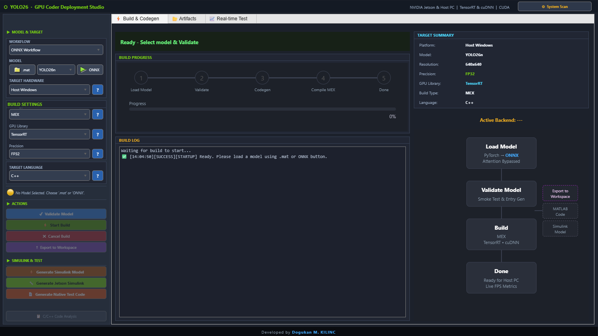
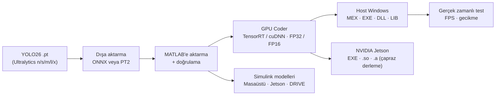
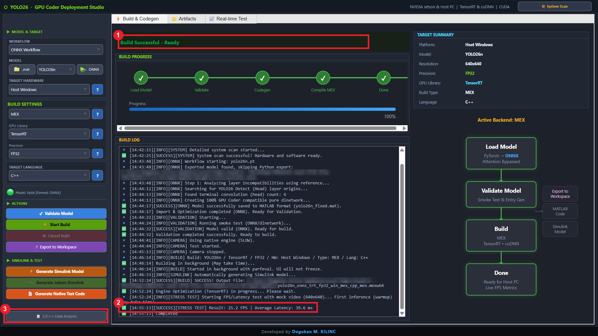
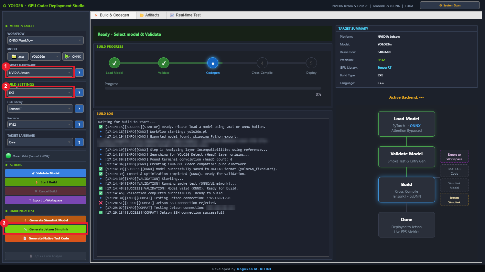
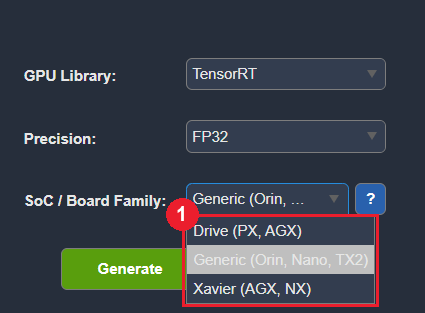

<div align="center">

# YOLO26 Deployment Studio

**PyTorch ağırlıklarından PC'nizde, NVIDIA Jetson'da veya NVIDIA DRIVE'da çalışan GPU koduna — tek bir MATLAB uygulamasıyla, dağıtım kodu yazmadan.**


[English → README.md](README.md) · [📖 Kullanım Kılavuzu → KULLANIM_KILAVUZU.md](docs/KULLANIM_KILAVUZU.md)

</div>



---

## Neden kullanmalısınız?

Bir nesne dedektörünü eğitim ortamından gömülü bir GPU'ya taşımak genellikle Python dışa aktarma betikleri, ONNX tuhaflıkları, GPU Coder yapılandırma nesneleri, derleyici yolları, TensorRT ayarları, SSH bağlantıları ve Simulink modelleriyle uğraşmak demektir. YOLO26 Deployment Studio bu zincirin tamamını, doğrulanmış ve yönlendirmeli adımlarla tek bir pencereye toplar:

| Ne yapmak istiyorsunuz? | Uygulama size ne sağlar? |
|---|---|
| **YOLO26'yı NVIDIA Jetson'da çalıştırmak** (robot, drone, akıllı kamera) | Karta SSH bağlantısı, çapraz derlenmiş CUDA/C++ (EXE / paylaşımlı kütüphane / statik kütüphane) ve kamera → YOLO26 → ekran zincirini içeren, dağıtıma hazır bir **Jetson Simulink modeli**. |
| **NVIDIA DRIVE platformunu hedeflemek** (otonom araç bilgisayarı) | Aynı pencereden, **NVIDIA DRIVE** donanım kartı için yapılandırılmış bir Simulink modeli (kamera, TensorRT/cuDNN çıkarım, ekran). |
| **PC'nizde çıkarımı hızlandırmak** | MATLAB'den çağırabileceğiniz TensorRT veya cuDNN **MEX**'i ve otomatik FPS / gecikme stres testi. |
| **Dedektörü başka bir uygulamaya gömmek** | C++, C#, Python vb. projelere bağlayabileceğiniz üretilmiş C++ kaynaklarıyla **DLL / LIB / EXE** derlemeleri. |
| **Motorları ve hassasiyetleri karşılaştırmak** | TensorRT ↔ cuDNN, FP32 ↔ FP16, C++ ↔ C arasında tek tıkla geçiş ve otomatik uyumluluk kontrolü. |
| **Model tabanlı çalışmak** | Masaüstü simülasyonu ve Jetson / DRIVE dağıtımı için otomatik üretilen Simulink modelleri. |
| **Sonucu hemen görmek** | Canlı FPS, gecikme ve tespit sayaçlarıyla gerçek zamanlı test sekmesi (webcam veya yerleşik simülasyon modu). |
| **GPU Coder'ın ne yaptığını anlamak** | Üretilen giriş fonksiyonları, kaynak dosyalar ve GPU Coder raporu tek tık uzağınızda; her seçeneğin *Basic* ve *Professional* açıklaması var. |

Tipik kullanıcılar: MATLAB'de prototip geliştiren robotik ve bilgisayarlı görü mühendisleri, algılama modellerini Jetson/DRIVE donanımına dağıtan ekipler ve GPU kod üretimini öğrenen öğrenciler.

---

## Ne yapar?



| Alan | Öne çıkanlar |
|---|---|
| **Modeller** | YOLO26n / s / m / l / x (COCO, 80 sınıf), 640×640 giriş. |
| **İçe aktarma yolları** | **ONNX** (`importNetworkFromONNX` → saf `dlnetwork`, GPU Coder'ın kabul ettiği yamalı dışa aktarma) ve **PT2** (`torch.export` → `loadPyTorchExportedProgram`). |
| **Kod üretimi** | GPU Coder, TensorRT veya cuDNN, FP32 / FP16, C++ / C, MEX / EXE / DLL / LIB; arka planda derleme (`parfeval`), hata ayıklama çıktısı, native fallback. |
| **Hedefler** | Host Windows (x86-64), NVIDIA Jetson (aarch64, ör. AGX Orin), NVIDIA DRIVE (Simulink yolu ile). |
| **Simulink** | Masaüstü test modeli (görüntü dosyası → YOLO26 → video viewer); kart, kütüphane ve hassasiyet ayarlı Jetson / DRIVE modeli (NVIDIA kamera → YOLO26 → SDL ekran). |
| **Test** | Webcam / simülasyon modu, native ve derlenmiş MEX karşılaştırması, bağımsız MATLAB test betiği üretimi, workspace'e aktarma. |
| **Yardım** | *Basic* / *Professional* açıklamalı **?** panelleri, System Scan, `install_requirements.m` tek tıkla kurulum. |

| Host Windows derlemesi | NVIDIA Jetson bağlı | Jetson / DRIVE Simulink ayarları |
|---|---|---|
|  |  |  |

---

## Gereksinimler

### Ana bilgisayar (PC)

| Öğe | Gereksinim | Not |
|---|---|---|
| İşletim sistemi | Windows 10/11 64-bit | Windows 11'de geliştirildi ve test edildi. |
| GPU | CUDA destekli NVIDIA GPU | FP16 için Tensor Core'lu (compute capability ≥ 7.0) önerilir. Referans: RTX 4050 Laptop (CC 8.9). |
| Sürücü | MATLAB sürümünüzün CUDA sürümünü destekleyen NVIDIA sürücüsü | `gpuDevice` ile kontrol edin. |
| MATLAB | **R2026a** (test edilen: R2026a Update 4) | |
| C/C++ derleyici | **Microsoft Visual C++** 2019/2022 | GPU Coder'ın CUDA derlemeleri için zorunlu (MinGW desteklenmez). `mex -setup C++` ile seçin. |
| Python | 3.10 – 3.12 (test edilen 3.11) | Yalnızca `.pt` → `.onnx` / `.pt2` dışa aktarımı için. Dışa aktarılmış model varsa gerekmez. |
| Python paketleri | `torch==2.8.0 torchvision==0.23.0 ultralytics==8.4.137 onnx==1.19.0` | Uygulama `pip install` önerir. |
| Disk | Uygulama, modeller ve derlemeler için ~1 GB | |

### MathWorks ürünleri

| Ürün | Durum | Kullanım amacı |
|---|---|---|
| Deep Learning Toolbox | **Zorunlu** | `dlnetwork`, `predict`, doğrulama |
| MATLAB Coder | **Zorunlu** | kod üretim altyapısı |
| GPU Coder | **Zorunlu** | CUDA kod üretimi (`coder.gpuConfig`) |
| Parallel Computing Toolbox | **Zorunlu** | GPU erişimi, arka planda derleme (`parfeval`) |
| Computer Vision Toolbox | **Zorunlu** | kutu çizimi, NMS yardımcıları |
| Image Processing Toolbox | **Zorunlu** | `imresize` ve ön işleme |
| Deep Learning Toolbox Converter for ONNX Model Format | **Zorunlu** (ONNX iş akışı) | `importNetworkFromONNX` |
| Deep Learning Toolbox Converter for PyTorch Model Format | **Zorunlu** (PT2 iş akışı) | PyTorch içe aktarma |
| MATLAB Coder Support Package for PyTorch and LiteRT Models | **Zorunlu** (PT2 iş akışı) | `loadPyTorchExportedProgram`, `.pt2` için kod üretimi |
| GPU Coder Interface for Deep Learning | **Zorunlu** | TensorRT / cuDNN hedefleri |
| MATLAB Support Package for USB Webcams | Kamera testleri için zorunlu | yoksa yalnızca simülasyon modu |
| Simulink, Simulink Coder | Opsiyonel | Simulink modeli üretimi |
| Embedded Coder | **Jetson / DRIVE için zorunlu** | gömülü hedefler (`ert.tlc`), çapraz derleme |
| MATLAB Coder Support Package for NVIDIA Jetson and NVIDIA DRIVE Platforms | **Jetson / DRIVE için zorunlu** | `jetson(...)` SSH bağlantısı, `coder.Hardware('NVIDIA Jetson')`, NVIDIA kamera / SDL ekran blokları |

### NVIDIA Jetson / DRIVE kartı

| Öğe | Gereksinim |
|---|---|
| Kart | NVIDIA Jetson (test edilen: **Jetson AGX Orin**, compute capability 8.7) veya NVIDIA DRIVE AGX |
| Yazılım | MATLAB sürümünüzün desteklediği JetPack / DRIVE OS; **CUDA, cuDNN ve TensorRT** kurulu |
| Simulink modeli için kütüphaneler | *SDL Video Display* bloğu için SDL 1.2 (`libsdl1.2-dev`), kamera için V4L2 / GStreamer |
| Ortam | SSH kullanıcısı için CUDA `bin` → `PATH`, CUDA `lib64` → `LD_LIBRARY_PATH` (ör. `~/.bashrc`) |
| Ağ | Kart ve PC aynı ağda, SSH açık; kartın IP adresi, kullanıcı adı ve parolası gerekli |
| Kamera | `/dev/video0` olarak görünen USB veya CSI kamera (üretilen Simulink modeli kullanır) |

> [!TIP]
> `install_requirements.m`'yi bir kez çalıştırın — MATLAB sürümünü kontrol eder, eksik eklentileri listeleyip açar, MSVC'yi ayarlar, GPU'yu kontrol eder, gerekirse Python 3.11'i ve paketlerini kurar ve uygulamayı kurmayı önerir. Uygulama içinde **⚙ System Scan** ortamı istediğiniz an yeniden kontrol eder.

---

## Kurulum

**Önerilen — paketlenmiş uygulama**

1. `install_requirements.m`'yi çalıştırın (yalnızca rapor için `install_requirements("CheckOnly")`).
2. `YOLO26 Deployment Studio.mlappinstall` dosyasını kurun (çift tıklayın veya kurulum betiğinin önerisini kabul edin).
3. MATLAB **APPS → YOLO26 Deployment Studio** ile başlatın.

**Kaynak koddan**

```matlab
cd C:\YOLO26App
YOLO26App_eng
```

> [!NOTE]
> `*.pt`, `*.onnx`, `*.pt2` ve `*.mat` dosyaları git'e dahil değildir. `.mlappinstall` paketi (~400 MB) bunları içerir. Kaynak koddan çalıştırırken **ONNX / PT2** düğmeleri bunları yeniden üretir; Ultralytics `.pt` ağırlıklarını ilk kullanımda indirir.

---

## Hızlı başlangıç

| Hedef | Adımlar |
|---|---|
| **PC'de GPU MEX** | Workflow **ONNX** → **ONNX** düğmesi → **Validate Model** → Hedef **Host Windows**, **MEX**, **TensorRT**, **FP32** → **Start Build** → **Real-time Test → MEX Test** |
| **Jetson çalıştırılabilir dosyası** | Modeli yükle + doğrula → Hedef **NVIDIA Jetson** (IP / kullanıcı / parola girin) → **EXE**, **TensorRT**, **FP16** → **Start Build** |
| **Jetson / DRIVE Simulink modeli** | Hedef **NVIDIA Jetson** (bağlı) → **Generate Jetson Simulink** → kütüphane, hassasiyet ve **SoC / Board Family** (Generic, Xavier veya **Drive**) → **Generate** |
| **Masaüstü Simulink modeli** | Modeli doğrula → **Generate Simulink Model** |

Her ekranın resimli, eksiksiz anlatımı **[Kullanım Kılavuzu](KULLANIM_KILAVUZU.md)**'ndadır.

---

## Referans sistemde ölçülenler

RTX 4050 Laptop GPU · YOLO26n · ONNX iş akışı · TensorRT · FP32 · MEX:

| Adım | Sonuç |
|---|---|
| ONNX içe aktarma + graf temizliği | ~30 sn |
| Kod üretimi + derleme | ~5,5 dk |
| İlk TensorRT çağrısı (motor oluşturma) | ~3 dk |
| **Stres testi (20 çalıştırma)** | **25,2 FPS · 39,6 ms** |

---

## Bilinen kısıtlar

* ONNX iş akışı GPU Coder uyumluluğu için `PSA` bloklarındaki dikkat dalını atlar; bu, orijinal Ultralytics modeline göre doğruluğu değiştirebilir.
* Giriş boyutu 640×640×3, batch 1 olarak sabittir. TensorRT motorları üretildikleri GPU'ya bağlıdır.
* **Start Build**, NVIDIA Jetson için çapraz derleme yapar (compute capability 8.7, Orin); NVIDIA DRIVE üretilen Simulink modeli üzerinden desteklenir.
* Windows 11 ve MATLAB R2026a üzerinde test edilmiştir.

---

## Proje yapısı

```
YOLO26App/
├── YOLO26App_eng.m                 # Uygulama (matlab.apps.AppBase)
├── YOLO26 Deployment Studio.mlappinstall
├── install_requirements.m          # Tek tıkla ortam kurulumu
├── decodeYOLO26.m                  # Ham ağ çıktısı → kutu / skor / etiket
├── create_yolo_simulink.m          # "Generate Simulink Model" tarafından yazılır
├── create_jetson_simulink.m        # "Generate Jetson Simulink" tarafından yazılır
├── ONNX_Workflow/  PT2_Workflow/   # Bağımsız step1…step4 betikleri
├── Weights/  YOLO26_Models/        # Model dosyaları (git dışı)
└── codegen/                        # GPU Coder çıktısı (derlemelerle oluşur)
```

---

## Yazar

**Doğukan M. KILINÇ** — [LinkedIn](https://www.linkedin.com/in/dgkilinc/)
