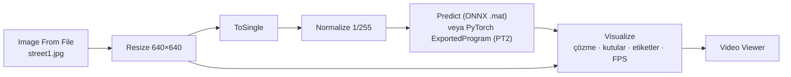
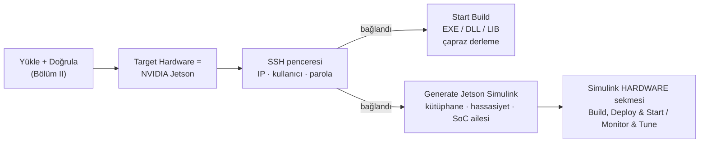
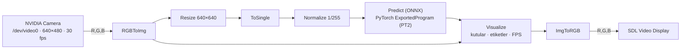
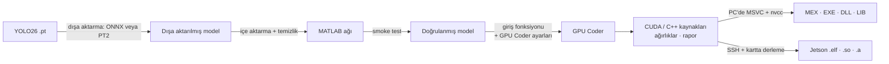
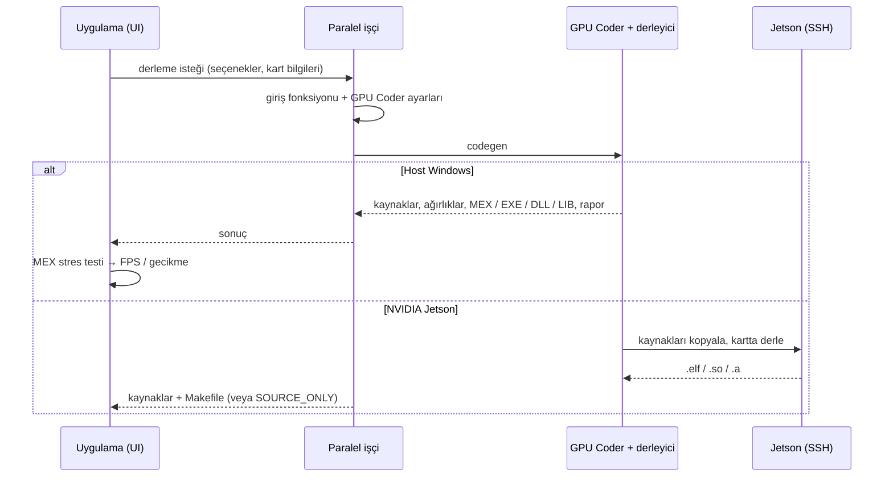

<div align="center">

# YOLO26 Deployment Studio — Kullanım Kılavuzu

**Tüm ekranlar için adım adım rehber: Host Windows, NVIDIA Jetson ve NVIDIA DRIVE iş akışları**

[README (English)](../README.md) · [README (Türkçe)](../README_TR.md) · [English Manual → USER_MANUAL.md](USER_MANUAL.md)

</div>

> **Ekran görüntüleri hakkında:** Tüm görüntüler çalışan uygulamadan alınmıştır (MATLAB R2026a, RTX 4050 Laptop GPU, yerel ağdaki NVIDIA Jetson AGX Orin). Numaralı kırmızı çerçeveler (①, ②, …) tıklanacak kontrolleri sırasıyla gösterir.

---

## İçindekiler

**Bölüm I – Başlarken**
1. [Başlamadan önce](#1-başlamadan-önce)
2. [Ana pencere](#2-ana-pencere)
3. [Gömülü yardım](#3-gömülü-yardım)

**Bölüm II – Ortak adımlar (tüm hedefler)**

4. [Modeli yükleyin](#4-modeli-yükleyin)
5. [Hedefi ve derleme ayarlarını seçin](#5-hedefi-ve-derleme-ayarlarını-seçin)
6. [Modeli doğrulayın](#6-modeli-doğrulayın)

**Bölüm III – Host Windows iş akışı**

7. [PC için GPU kodu derleyin](#7-pc-için-gpu-kodu-derleyin)
8. [Üretilen kodu inceleyin](#8-üretilen-kodu-inceleyin)
9. [Gerçek zamanlı test](#9-gerçek-zamanlı-test)
10. [Masaüstü Simulink modeli](#10-masaüstü-simulink-modeli)
11. [Test betikleri ve workspace'e aktarma](#11-test-betikleri-ve-workspacee-aktarma)

**Bölüm IV – NVIDIA Jetson iş akışı**

12. [Jetson kartını hazırlayın](#12-jetson-kartını-hazırlayın)
13. [Jetson'a bağlanın](#13-jetsona-bağlanın)
14. [Jetson için çapraz derleme](#14-jetson-için-çapraz-derleme)
15. [Jetson Simulink modelini üretin](#15-jetson-simulink-modelini-üretin)
16. [Simulink modelini karta dağıtın](#16-simulink-modelini-karta-dağıtın)

**Bölüm V – NVIDIA DRIVE iş akışı**

17. [DRIVE Simulink modeli üretin](#17-drive-simulink-modeli-üretin)

**Bölüm VI – Perde arkası**

18. [Kod nasıl üretiliyor?](#18-kod-nasıl-üretiliyor)

**Bölüm VII – Başvuru**

19. [Seçenekler ve uyumluluk kuralları](#19-seçenekler-ve-uyumluluk-kuralları)
20. [Çıktılar ve dosya adları](#20-çıktılar-ve-dosya-adları)
21. [Ölçülen süreler](#21-ölçülen-süreler)
22. [Sorun giderme](#22-sorun-giderme)

---

# Bölüm I – Başlarken

## 1. Başlamadan önce

1. [README](../README.md#gereksinimler)'deki gereksinimlerin kurulu olduğundan emin olun — en hızlı yol `install_requirements.m`'yi bir kez çalıştırmaktır.
2. Uygulamayı başlatın: **APPS → YOLO26 Deployment Studio**.
3. Sağ üstteki **⚙ System Scan** ① düğmesine tıklayın. MATLAB sürümünü, seçili C++ derleyicisini, GPU'yu ve compute capability değerini, dört temel toolbox'ı ve cuDNN / TensorRT kod üretim arayüzlerinin kullanılabilirliğini kontrol eder.


## 2. Ana pencere


| | Bölge | Amacı |
|---|---|---|
| **A** | **Model & Target** | *Workflow* (ONNX / PT2), *Model* boyutu (YOLO26n…x), **.mat / .pt2** (hazır model dosyası seçme), **ONNX / PT2** (içe aktarma iş akışını çalıştırma), *Target Hardware* (Host Windows / NVIDIA Jetson). |
| **B** | **Build Settings** | *Build Type* (MEX / EXE / DLL / LIB), *GPU Library* (TensorRT / cuDNN), *Precision* (FP32 / FP16). |
| **C** | **Target Language** | C++ veya C. |
| **D** | **Model durum lambası** | Sarı = model yok / bekliyor, turuncu = işleniyor, yeşil = yüklendi / geçerli, kırmızı = hata. |
| **E** | **Actions** | Validate Model, Start Build, Cancel Build, Export to Workspace. |
| **F** | **Simulink & Test** | Generate Simulink Model, Generate Jetson Simulink, Generate Native Test Code, Generate MEX Test Code (yalnızca PT2), C/C++ Code Analysis. |
| **G** | **Sekmeler** | *Build & Codegen*, *Artifacts*, *Real-time Test*. |
| **H** | **Durum bandı** | Anlık durum. |
| **I** | **Build Progress** | 5 adımlı akış + ilerleme çubuğu; adım adları yapılan işe göre değişir (Host derleme, Jetson çapraz derleme, Simulink, Jetson Simulink, MATLAB kodu, Export). |
| **J** | **Build Log** | `[SS:DD:ss][SEVİYE][MODÜL] mesaj`. |
| **K** | **Target Summary** | Platform, model, çözünürlük, hassasiyet, kütüphane, derleme türü, dil. |
| **L** | **Aktif backend + akış diyagramı** | MEX / NATIVE ve yan dalları (Export, MATLAB kodu, Simulink, Jetson Simulink) olan canlı akış şeması. |
| **M** | **System Scan** | Ortam kontrolü. |

## 3. Gömülü yardım

Her **?** düğmesi sağdan kayan bir panel açar. **Detail Level** anahtarı sade dilli *Basic* ile teknik *Professional* açıklama arasında geçiş yapar.

| Hardware Target – Basic ① | Hardware Target – Professional ① |
|---|---|
|  |  |

| Build Type ① | GPU Library ① |
|---|---|
|  |  |

| Precision ① | Target Language ① |
|---|---|
|  |  |

---

# Bölüm II – Ortak adımlar (tüm hedefler)

## 4. Modeli yükleyin

1. ① **Workflow** seçin: `ONNX Workflow` veya `PT2 Workflow`.
2. ② **Model** boyutunu seçin (`YOLO26n` … `YOLO26x`).
3. ③ İçe aktarma iş akışı için **ONNX** (veya **PT2**) düğmesine tıklayın — ya da hazır bir model dosyası için **.mat / .pt2** düğmesini kullanın.


**ONNX** düğmesinin yaptıkları:

1. Dışa aktarılmış model zaten varsa (paket YOLO26n'i içerir) Python atlanır. Yoksa uygulama Python 3'ü bulur (MATLAB `pyenv` → `py` başlatıcısı → `PATH`'teki `python`), `torch`, `ultralytics`, `onnx` paketlerini kontrol eder (eksikse `pip install` önerir) ve `yolo26<boyut>.pt` için uygulamanın ONNX dışa aktarma adımını çalıştırır (Ultralytics ağırlıkları ilk kullanımda indirir).
2. ONNX dosyasını içe aktarır, tespit başlıklarından sonraki her şeyi temizler ve MATLAB modelini (`yolo26<boyut>_fixed.mat`) uygulamanın model klasörüne kaydeder.
3. Lamba yeşile döner ("Model: YOLO26n (ONNX)") ve **Validate Model** etkinleşir.

**PT2 Workflow**'da düğmenin adı **PT2** olur: model `torch.export` ile dışa aktarılır ve `loadPyTorchExportedProgram` ile yüklenir (bellekte tutulur). PT2 modunda **Generate MEX Test Code** düğmesi de görünür.

| PT2 iş akışı ①, PT2 düğmesi ② | PT2 modeli yüklendi |
|---|---|
|  |  |

> [!NOTE]
> Referans PC'de ONNX içe aktarma ~30 sn, `.pt2` yükleme ~3,5 dk sürdü.

## 5. Hedefi ve derleme ayarlarını seçin

| Ayar | Seçim |
|---|---|
| **Target Hardware** | Bu PC'de çalıştırmak için *Host Windows*; Jetson'a çapraz derleme ve Jetson / DRIVE Simulink modelleri için *NVIDIA Jetson* (bkz. Bölüm IV). |
| **Build Type** | *MEX* (MATLAB'den çağrılır, yalnızca Windows), *EXE* (bağımsız program), *DLL* (paylaşımlı kütüphane: `.dll` / `.so`), *LIB* (statik kütüphane: `.lib` / `.a`). |
| **GPU Library** | *TensorRT* (en hızlı, ilk derleme uzun) veya *cuDNN* (hızlı kurulum, esnek). |
| **Precision** | *FP32* veya *FP16* (yalnızca TensorRT; hız kazancı için Tensor Core gerekir). |
| **Target Language** | *C++* (TensorRT ile her zaman) veya *C* (yalnızca cuDNN). |

Geçersiz kombinasyonlar otomatik düzeltilir — ör. **cuDNN** ① seçilince **Precision** ② yalnızca FP32 olur ve C dili açılır:


## 6. Modeli doğrulayın

**✔ Validate Model** ① düğmesine tıklayın. Model yüklenir ve smoke test çalıştırılır (ONNX: 640×640×3 `dlarray` ile `predict`, varsa GPU'da; PT2: `[1 3 640 640]` single dizi ile CPU'da `invoke`). Diske hiçbir şey yazılmaz. Ardından *Start Build*, *Export to Workspace*, *Generate Simulink Model* ve *Generate Native Test Code* etkinleşir (hedef bağlı bir Jetson ise *Generate Jetson Simulink* de).


---

# Bölüm III – Host Windows iş akışı

## 7. PC için GPU kodu derleyin

**Target Hardware = Host Windows** iken **⚡ Start Build** ① düğmesine tıklayın. Derleme paralel bir işçide (`parfeval`; process pool otomatik açılır) çalışır, arayüz donmaz; **✖ Cancel Build** ile durdurulabilir. LIB derlemeleri senkron çalışır (MSVC `lib.exe` `parfeval` içinde çalışmaz).


Derleme bitince uygulama çıktı dosyasını bildirir, MEX derlemelerinde **stres testi** yapar (bir ısınma çağrısı — ilk TensorRT çağrısı motoru oluşturur — + 20 zamanlanmış çağrı) ②, **Build Successful – Ready** ① gösterir, *Active Backend: MEX* yapar ve **MEX Test (Fast)** ile **📋 C/C++ Code Analysis** ③ düğmelerini etkinleştirir.


Derleme başarısız olursa hata satırları (codegen çıktısı, `buildLog.log`, istisna zinciri) log'a yazılır ve uygulama MATLAB içi çıkarıma döner ("Native Fallback").

## 8. Üretilen kodu inceleyin

**Artifacts ①** üretilen tüm `.cu` / `.cpp` / `.h` dosyalarını ve ikili dosyayı listeler. **🔍 Compiled Output Folder ②** `codegen` klasörünü, **📂 Main Project Folder** uygulamanın çalışma klasörünü açar.


**📋 C/C++ Code Analysis** GPU Coder raporunu açar: giriş fonksiyonu, üretilen dosyalar, GPU kernel'leri, derleme kayıtları ve mesajlar.


## 9. Gerçek zamanlı test

**📈 Real-time Test** ① sekmesini açın, bir kamera seçin ② (veya MATLAB demo görüntülerinden oluşan kayan panoramayı oynatan **Simulation Mode**) ve başlatın:

* **Native Test (Slow)** ③ – ağı MATLAB içinde çalıştırır (doğrulanmış model gerekir).
* **MEX Test (Fast)** – derlenmiş MEX'i çalıştırır (MEX derlemesinden sonra).
* **⏹ Stop** – kamerayı durdurur.

Her kare 640×640'a boyutlandırılır, normalize edilir, ağdan geçirilir, çözülür (eşik, kutu çözme, NMS) ve COCO etiketleriyle çizilir. Sağ panelde backend, **FPS** (30 kare ortalaması), **gecikme** (çıkarım + çözme), **tespit** ve **toplam kare** gösterilir. Test her zaman PC üzerinde çalışır.


## 10. Masaüstü Simulink modeli

**⚡ Generate Simulink Model** ① `YOLO26_Simulink_Auto` modelini oluşturur ve açar.




## 11. Test betikleri ve workspace'e aktarma

* **📄 Generate Native Test Code** ① bağımsız bir MATLAB betiği yazar (model yükleme, altı demo görüntü, son işleme, işaretli çıktı) ve Editor'da *Untitled* belge olarak açar.
* **⚙ Generate MEX Test Code** (PT2, MEX derlemesinden sonra) aynı betiği derlenmiş MEX ile yazar.
* **↑ Export to Workspace** doğrulanmış ağı base workspace'e `yolo26<boyut>_dlnetwork` olarak kopyalar.

| Generate Native Test Code ① | Üretilen betiğin çıktısı |
|---|---|
|  |  |


---

# Bölüm IV – NVIDIA Jetson iş akışı



## 12. Jetson kartını hazırlayın

Her kart için bir kez kontrol edin (referans kart: **Jetson AGX Orin**, compute capability 8.7):

- [ ] MATLAB sürümünüzün desteklediği bir JetPack, **CUDA, cuDNN ve TensorRT** ile birlikte kurulu.
- [ ] *SDL Video Display* bloğu için SDL 1.2 (`sudo apt install libsdl1.2-dev`); kamera bloğu için `/dev/video0` üzerinde bir USB/CSI kamera.
- [ ] SSH kullanıcısının ortamında CUDA tanımlı, ör. `~/.bashrc` içinde:
  ```bash
  export PATH=/usr/local/cuda/bin:$PATH
  export LD_LIBRARY_PATH=/usr/local/cuda/lib64:$LD_LIBRARY_PATH
  ```
- [ ] SSH açık, kart ve PC aynı ağda; IP adresini, kullanıcı adını ve parolayı biliyorsunuz.
- [ ] PC'de Embedded Coder ve *MATLAB Coder Support Package for NVIDIA Jetson and NVIDIA DRIVE Platforms* kurulu.

## 13. Jetson'a bağlanın

1. Bir modeli yükleyip doğrulayın (Bölüm II).
2. **Target Hardware**'i **NVIDIA Jetson** yapın. **NVIDIA Jetson SSH Connection** penceresi açılır:
   ① **Jetson IP Address** — varsayılan `192.168.1.50`'yi silip kartınızın adresini yazın,
   ② **Username** — varsayılan `ubuntu`'yu değiştirin,
   ③ **Password**,
   ④ **OK**.


Uygulama bağlantıyı `jetson(ip, kullanıcı, parola)` ile test eder (referans ağda ≈5 sn).

* **Başarılı:** log'da *"Jetson SSH connection successful!"* görünür ve pencere Jetson moduna geçer: ① *Target Hardware = NVIDIA Jetson*, ② MEX'siz *Build Type*, ③ **Generate Jetson Simulink** etkin. Akış artık *Load Model → Validate → Codegen → Cross-Compile → Deploy* olur; akış şemasında *Cross-Compile* / *Deployed to Jetson* ve yeni bir **Jetson Simulink** yan dalı görünür.
* **Başarısız** (yanlış IP / kullanıcı / parola, SSH kapalı, farklı ağ): *SSH Connection Error* mesajı çıkar, log'da *"Jetson SSH connection rejected."* yazar ve hedef *Host Windows*'a döner. Aşağıdaki görüntüde ilk deneme, pencerede varsayılan IP bırakıldığı için başarısız olmuştur.


> [!IMPORTANT]
> Penceredeki parola alanı maskelenmez — ekranınıza kimsenin bakmadığından emin olun. Kimlik bilgileri yalnızca o oturum boyunca uygulamanın belleğinde tutulur (çapraz derleme için kullanılır) ve diske yazılmaz.

## 14. Jetson için çapraz derleme

1. **Build Type** ① — Jetson'da yalnızca **EXE** (Linux çalıştırılabilir), **DLL** (`.so`) ve **LIB** (`.a`) sunulur:

   

2. **GPU Library** ve **Precision** seçin — ör. Orin'in Tensor Core'ları için TensorRT + FP16.
3. **⚡ Start Build** ① düğmesine tıklayın. *Target Summary*'de *Platform: NVIDIA Jetson* görünür; akış *Codegen*'e, ardından *Cross-Compile* ve *Deploy*'a ilerler.


Jetson derlemesinde olanlar:

1. Seçeneklere göre bir giriş fonksiyonu yazılır, ör. `yolo26n_onnx_trt_fp16_jetson_exe_cpp.m`.
2. GPU Coder; `coder.Hardware('NVIDIA Jetson')`, kartın adresi / kullanıcısı / parolası, compute capability **8.7**, seçilen derin öğrenme kütüphanesi ve hassasiyetle yapılandırılır.
3. CUDA/C++ kodu PC'de üretilir, SSH ile karta kopyalanır ve kartın CUDA / TensorRT araç zinciriyle **kart üzerinde** derlenir.
4. Uygulama üretilen kaynakları (`codegen/<tür>/<giriş>/`) ve Makefile'ı (`<giriş>.mk`) listeler. Kod üretiminden sonra karta ulaşılamazsa sonuç **SOURCE_ONLY (SSH Connection Error)** olarak bildirilir — kaynaklar yine karta kopyalanıp orada derlenebilir.

> [!NOTE]
> Bu kılavuz için derleme başlatıldı ve **✖ Cancel Build** ② ile durduruldu. İptalden sonra durum *Build Failed – Native Fallback* olur; bu beklenen davranıştır. Tam bir Jetson derlemesi birkaç dakika sürer (kod üretimi + kart üzerinde derleme).

## 15. Jetson Simulink modelini üretin

**🔧 Generate Jetson Simulink** düğmesine tıklayın (yalnızca hedef bağlı bir Jetson ve model doğrulanmışsa etkindir). **Jetson Simulink Settings** penceresi açılır:

| Varsayılan ayarlar: ① GPU Library ② Precision ③ SoC / Board Family ④ **?** ⑤ Generate | cuDNN seçildi ① → Precision FP32'ye kilitlenir ② |
|---|---|
|  |  |

**SoC / Board Family** seçenekleri ① ve **?** bilgi penceresi (*Basic* / *Professional*, anahtar ①):

| Kart ailesi listesi | **?** – Basic | **?** – Professional |
|---|---|---|
|  |  |  |

| Kart ailesi | Kullanım | Uygulamanın ayarladığı Simulink *Hardware board* |
|---|---|---|
| **Generic (Orin, Nano, TX2)** | Jetson AGX Orin, Orin Nano, Orin NX, TX2, … (en yaygın) | `NVIDIA Jetson` |
| **Xavier (AGX, NX)** | Jetson AGX Xavier / Xavier NX | `NVIDIA Jetson` |
| **Drive (PX, AGX)** | NVIDIA DRIVE platformları (Bölüm V) | `NVIDIA Drive` |

Jetson AGX Orin için ① **TensorRT**, ② **FP16**, ③ **Generic (Orin, Nano, TX2)** seçip ④ **Generate**'e tıklayın:


Uygulama **`YOLO26_Jetson_Auto`** modelini oluşturur ve açar. Log'da *"Jetson Simulink Model … opened!"* görünür ve akış *Load Model → Validate → Configure → Jetson Simulink → Done* olur (referans PC'de ≈30 sn):


Model:




| Model ayarı | Değer |
|---|---|
| System target file | `ert.tlc` (Embedded Coder) |
| Hardware board | `NVIDIA Jetson` (Generic / Xavier) veya `NVIDIA Drive` (Drive) |
| Hedef dil | C++ |
| GPU kodu | CUDA, compute capability 8.7 |
| Derin öğrenme kütüphanesi | TensorRT veya cuDNN; veri tipi FP32/FP16 (TensorRT) |
| Değişken boyutlu sinyaller / dinamik bellek | açık / açık |

> [!TIP]
> Model her zaman compute capability **8.7** (Orin) kullanır. **Xavier** kartında *Configuration Parameters → Code Generation → GPU Code → Compute capability* değerini **7.2**, TX2'de **6.2** yapın.

## 16. Simulink modelini karta dağıtın

Model **HARDWARE** sekmesiyle açılır:


1. ① **Hardware Board** `NVIDIA Jetson` gösterir.
2. ② **Hardware Settings** → *Hardware Implementation → Target hardware resources → Board Parameters*: kartın **Device Address**, **Username** ve **Password** (**Edit**) bilgilerini girin. Uygulama SSH bilgilerini modele kopyalamaz. (Aşağıdaki görüntü DRIVE modelinden alınmıştır; Jetson modelinde sayfa aynıdır, yalnızca *Hardware board = NVIDIA Jetson* olur.)

   

3. ③ **Monitor & Tune** – Simulink bağlı kalırken modeli kartta çalıştırır (external mode: sinyalleri izleme, parametre ayarlama).
4. ④ **Deploy → Build, Deploy & Start** – tüm model için kod üretir, kartta derler ve bağımsız bir uygulama olarak başlatır; işaretli video kartın ekranında (SDL penceresi) görünür.

---

# Bölüm V – NVIDIA DRIVE iş akışı

## 17. DRIVE Simulink modeli üretin

DRIVE iş akışı Jetson Simulink modeliyle aynı pencereyi kullanır; yalnızca kart ailesi farklıdır.

1. Modeli yükleyip doğrulayın (Bölüm II).
2. **Target Hardware = NVIDIA Jetson** seçin ve kartın IP adresi, kullanıcı adı ve parolasıyla bağlanın (§13) — Simulink düğmesi yalnızca başarılı bağlantıdan sonra etkinleşir.
3. **🔧 Generate Jetson Simulink**'e tıklayın, **SoC / Board Family** listesinden ① **Drive (PX, AGX)** seçin; kütüphane ve hassasiyeti seçip ② **Generate**'e tıklayın:

   

4. `YOLO26_Jetson_Auto`, ① **Hardware Board = NVIDIA Drive** ile açılır (bloklar §15 ile aynı):

   

5. ② **Hardware Settings**: kart `NVIDIA Drive` ① (ARM Cortex-A 64-bit, `ert.tlc`); DRIVE platformunun **Device Address / Username / Password** ② bilgilerini girin (parola **Edit** ③ ile):

   

6. §16'daki gibi ③ **Monitor & Tune** veya ④ **Deploy → Build, Deploy & Start** kullanın.

> [!NOTE]
> Uygulamadaki **Start Build** her zaman `coder.Hardware('NVIDIA Jetson')` ile çapraz derleme yapar. NVIDIA DRIVE için bu Simulink yolunu kullanın. DRIVE platformunda CUDA, cuDNN ve TensorRT içeren DRIVE OS, PC'de ise aynı destek paketi gerekir.

---

# Bölüm VI – Perde arkası

## 18. Kod nasıl üretiliyor?



### 18.1 Dışa aktarma

* **ONNX:** ONNX dosyası yazılmadan önce (opset 14, 640×640, batch 1, statik boyutlar, FP32) uygulama Ultralytics modelini MATLAB'e uyarlar: tespit başlığı **altı ham tensör** döndürür (stride 8, 16 ve 32 için kutu mesafeleri ve sınıf skorları), böylece son işleme MATLAB'de yapılır; kanal bölme ve dikkat (attention) işlemleri GPU Coder'ın desteklediği biçimde yeniden yazılır; PSA bloklarındaki dikkat dalı atlanır (doğruluğu biraz değiştirebilir).
* **PT2:** model, uçtan uca NMS kapatılarak `torch.export` ile dışa aktarılır; bu, grafı TensorRT dostu tutar. Tek bir `[1, 84, 8400]` tensör döndürür (8400 aday için 4 kutu değeri + 80 sınıf skoru).

### 18.2 İçe aktarma ve doğrulama

* **ONNX:** dosya MATLAB ağı olarak içe aktarılır, tespit başlıkları bulunur ve sonrasındaki her şey silinir; sonuç saf bir `dlnetwork`'tür. YOLO26n için: **324 katman, ~2,50 M parametre**, çıkışlar `80×80×4 / 80×80×80` (stride 8), `40×40×4 / 40×40×80` (stride 16), `20×20×4 / 20×20×80` (stride 32).
* **PT2:** `.pt2` dosyası PyTorch ExportedProgram olarak yüklenir.
* Kod üretmeden önce 640×640×3 girişli bir smoke test ağın çalıştığını doğrular.

### 18.3 Giriş fonksiyonu

GPU Coder, kodu bir MATLAB *giriş fonksiyonundan* (entry-point) üretir. Uygulama her derlemede bir tane yazar; adı seçilen seçenekleri içerir:

```
<model>_<kaynak>_<kütüphane>_<hassasiyet>_<donanım>_<derlemetürü>_<dil>
yolo26n_onnx_trt_fp32_win_mex_cpp        (Host Windows MEX)
yolo26n_onnx_trt_fp16_jetson_exe_cpp     (Jetson EXE)
```

ONNX giriş fonksiyonu ağı bir kez yükler ve `predict` çağırır (GPU Coder raporunda görünen fonksiyon budur, §8):

```matlab
function [o1, o2, o3, o4, o5, o6] = yolo26n_onnx_trt_fp32_win_mex_cpp(in)
    %#codegen
    persistent net;
    if isempty(net)
        net = coder.loadDeepLearningNetwork('yolo26n_fixed.mat', 'net');
    end
    X = dlarray(in, 'SSCB');
    [o1, o2, o3, o4, o5, o6] = predict(net, X);
end
```

PT2 giriş fonksiyonu ExportedProgram'ı yükler, girişi NCHW'ye çevirir ve `invoke` çağırır.

### 18.4 GPU Coder ayarları

| Uygulamadaki seçiminiz | GPU Coder ayarı |
|---|---|
| Build Type | `coder.gpuConfig('mex' / 'exe' / 'dll' / 'lib')`; EXE derlemeleri örnek bir `main` içerir |
| Target Language | `TargetLang = 'C++'` veya `'C'` |
| GPU Library, Precision | `coder.DeepLearningConfig('tensorrt' / 'cudnn')`; TensorRT veri tipi `fp32` / `fp16` |
| Host Windows | yerel GPU'nun compute capability değeri; MATLAB ile gelen CUDA, cuDNN ve TensorRT |
| NVIDIA Jetson | kartın adresi ve kimlik bilgileriyle `coder.Hardware('NVIDIA Jetson')`; compute capability 8.7 |
| Giriş | sabit `single` dizi 640×640×3×1 |
| Rapor | GPU Coder raporu her zaman üretilir |



### 18.5 Son işleme

* **ONNX çıkışları:** sınıf skorlarına sigmoid → her ızgara hücresi için en iyi sınıf → güven eşiği → tahmin edilen mesafelerden kutu: `x1 = (gx + 0.5 − l)·stride`, `y1 = (gy + 0.5 − t)·stride`, `x2 = (gx + 0.5 + r)·stride`, `y2 = (gy + 0.5 + b)·stride`.
* **PT2 çıkışı:** `cx, cy, w, h` + 80 sınıf skoru → eşik → köşe koordinatları.
* Sınıf bazlı **non-maximum suppression** (IoU > 0.45) → kutular, skorlar ve COCO etiketleri (1…80). Güven eşiği üretilen test betiklerinde ve Simulink modellerinde 0.20, gerçek zamanlı test sekmesinde 0.05'tir.

---

# Bölüm VII – Başvuru

## 19. Seçenekler ve uyumluluk kuralları

| Kural | Sonuç |
|---|---|
| Hedef = NVIDIA Jetson | MEX kalkar → EXE / DLL / LIB |
| Kütüphane = cuDNN | Yalnızca FP32; C++ veya C |
| Kütüphane = TensorRT | FP32 / FP16; yalnızca C++ |
| Jetson Simulink penceresi: cuDNN | Precision kapalı (FP32) |
| Generate Jetson Simulink | Doğrulanmış model **ve** bağlı NVIDIA Jetson hedefi gerekir |

|  | MEX | EXE | DLL | LIB | Simulink modeli |
|---|:-:|:-:|:-:|:-:|:-:|
| Host Windows | ✔ | ✔ | ✔ | ✔ | Masaüstü |
| NVIDIA Jetson | ✖ | ✔ | ✔ | ✔ | Jetson (Generic / Xavier) |
| NVIDIA DRIVE | ✖ | – | – | – | DRIVE (Jetson Simulink penceresi ile) |

## 20. Çıktılar ve dosya adları

| Derleme türü | Host Windows | NVIDIA Jetson |
|---|---|---|
| MEX | `<giriş>_mex.mexw64` (uygulama çalışma klasörü) | – |
| EXE | `codegen\exe\<giriş>\<giriş>.exe` | `<giriş>.elf` (kartta derlenir) |
| DLL | `codegen\dll\<giriş>\<giriş>.dll` | `.so` |
| LIB | `codegen\lib\<giriş>\<giriş>.lib` | `.a` |

| Uygulamanın ürettiği | Dosya / nesne |
|---|---|
| İçe aktarma (ONNX) | `yolo26<boyut>_fixed.mat` (MATLAB modeli) |
| Derleme | giriş fonksiyonu `<giriş>.m`, `codegen/<tür>/<giriş>/…`, `html/report.mldatx` |
| Generate Simulink Model | `YOLO26_Simulink_Auto` modeli |
| Generate Jetson Simulink | `YOLO26_Jetson_Auto` modeli |
| Generate Native / MEX Test Code | Editor'da *Untitled* betik |
| Export to Workspace | `yolo26<boyut>_dlnetwork` |

Üretilen modeller otomatik kaydedilmez — saklamak isterseniz Simulink'te **Save** kullanın.

## 21. Ölçülen süreler

| Adım | Referans sonuç |
|---|---|
| System Scan | ~10 sn |
| ONNX içe aktarma (mevcut `.onnx`) | ~30 sn |
| PT2 yükleme | ~3,5 dk |
| Doğrulama | ~10 sn |
| Host MEX derleme (TensorRT FP32) | ~5,5 dk + ilk TensorRT çağrısı ~3 dk |
| **Host MEX stres testi** | **25,2 FPS · 39,6 ms** |
| Native gerçek zamanlı test (simülasyon) | ~7,8 FPS · ~44 ms |
| Jetson SSH bağlantı testi | ~5 sn (başarısız deneme ~20 sn) |
| Jetson derleme başlangıcı (paralel havuz dahil) | kod üretimi başlayana kadar ~80 sn |
| Jetson Simulink modeli üretimi | ~30 sn |

## 22. Sorun giderme

| Belirti | Neden | Çözüm |
|---|---|---|
| *Jetson SSH connection rejected* / hedef Host Windows'a dönüyor | Yanlış IP (varsayılan `192.168.1.50` bırakılmış), kullanıcı veya parola; SSH kapalı; farklı ağ | Kartın gerçek IP / kullanıcı / parolasını girin; PC'den `ping` ve `ssh kullanıcı@ip` ile kontrol edin. |
| **Generate Jetson Simulink** gri | Hedef bağlı bir Jetson değil veya model doğrulanmamış | Bağlanın (§13) ve doğrulayın (§6). |
| Jetson derlemesi **SOURCE_ONLY (SSH Connection Error)** ile bitiyor | Uzak derleme sırasında karta ulaşılamadı | Ağı kontrol edin; veya `codegen/<tür>/<giriş>` klasörünü karta kopyalayıp Makefile'ı orada çalıştırın. |
| Kartta *SDL Video Display* / kamera hataları | SDL 1.2 eksik, `/dev/video0`'da kamera yok | `sudo apt install libsdl1.2-dev`; kamera takın; `ls /dev/video*` ile kontrol edin. |
| Kart üzerindeki derlemede CUDA bulunamıyor | SSH kullanıcısı için `PATH` / `LD_LIBRARY_PATH` tanımsız | CUDA export satırlarını `~/.bashrc`'ye ekleyin (§12). |
| Xavier / TX2'de yanlış GPU mimarisi | Model compute capability 8.7 kullanıyor | Modelin GPU Code ayarında 7.2 (Xavier) veya 6.2 (TX2) yapın. |
| *Python 3 was not found* | Kullanılabilir yorumlayıcı yok | Python 3.10–3.12 kurun (PATH'e ekleyin) veya `pyenv` ayarlayın; dışa aktarılmış model varsa gerekmez. |
| *TensorRT Missing* | GPU Coder TensorRT kütüphanesi kurulu değil | `gpucoder.installTensorRT` |
| *No C++ compiler selected* | MEX derleyicisi yok | `mex -setup C++` → MSVC |
| Derleme başarısız → *Native Fallback* | Log'a bakın | `coder.checkGpuInstall` |
| İlk MEX çağrısı çok yavaş | TensorRT motoru oluşturuluyor | Bekleyin; sonraki çağrılar hızlıdır. |
| Kamera listesinde yalnızca *Simulation Mode* | USB Webcams destek paketi eksik / kamera yok | Kurun, **🔄 Refresh**'e basın. |
| LIB derlemesinde arayüz donuyor | LIB derlemeleri senkron | Bekleyin. |
