<div align="center">

# YOLO26 Deployment Studio — User Manual

**Step-by-step guide for every screen: Host Windows, NVIDIA Jetson and NVIDIA DRIVE workflows**

[README](../README.md) · [Türkçe kılavuz → KULLANIM_KILAVUZU.md](KULLANIM_KILAVUZU.md)

</div>

> **About the screenshots:** all screenshots were taken from the running application (MATLAB R2026a, RTX 4050 Laptop GPU, NVIDIA Jetson AGX Orin on the local network). Red frames with numbers (①, ②, …) mark the controls to click, in order.

---

## Contents

**Part I – Getting started**
1. [Before you start](#1-before-you-start)
2. [The main window](#2-the-main-window)
3. [Built-in help](#3-built-in-help)

**Part II – Common steps (every target)**

4. [Load a model](#4-load-a-model)
5. [Choose the target and build settings](#5-choose-the-target-and-build-settings)
6. [Validate the model](#6-validate-the-model)

**Part III – Host Windows workflow**

7. [Build GPU code for the PC](#7-build-gpu-code-for-the-pc)
8. [Inspect the generated code](#8-inspect-the-generated-code)
9. [Real-time test](#9-real-time-test)
10. [Desktop Simulink model](#10-desktop-simulink-model)
11. [Test scripts and workspace export](#11-test-scripts-and-workspace-export)

**Part IV – NVIDIA Jetson workflow**

12. [Prepare the Jetson board](#12-prepare-the-jetson-board)
13. [Connect to the Jetson](#13-connect-to-the-jetson)
14. [Cross-compile for the Jetson](#14-cross-compile-for-the-jetson)
15. [Generate the Jetson Simulink model](#15-generate-the-jetson-simulink-model)
16. [Deploy the Simulink model to the board](#16-deploy-the-simulink-model-to-the-board)

**Part V – NVIDIA DRIVE workflow**

17. [Generate a DRIVE Simulink model](#17-generate-a-drive-simulink-model)

**Part VI – Under the hood**

18. [How the code is generated](#18-how-the-code-is-generated)

**Part VII – Reference**

19. [Options and compatibility rules](#19-options-and-compatibility-rules)
20. [Outputs and file names](#20-outputs-and-file-names)
21. [Measured timings](#21-measured-timings)
22. [Troubleshooting](#22-troubleshooting)

---

# Part I – Getting started

## 1. Before you start

1. Make sure the requirements in the [README](../README.md#requirements) are installed — the quickest way is to run `install_requirements.m` once.
2. Start the app: **APPS → YOLO26 Deployment Studio**.
3. Click **⚙ System Scan** ① (top right). It checks the MATLAB release, the selected C++ compiler, the GPU and its compute capability, the four core toolboxes and whether the cuDNN and TensorRT code-generation interfaces are available.

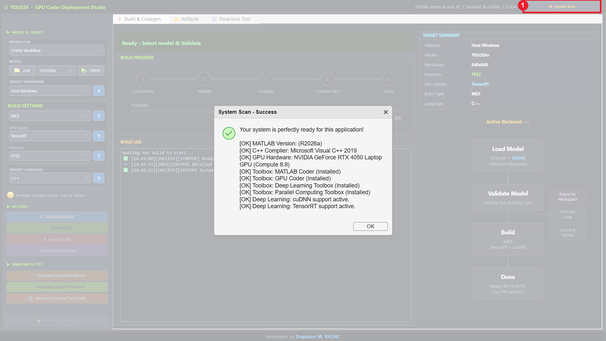

## 2. The main window

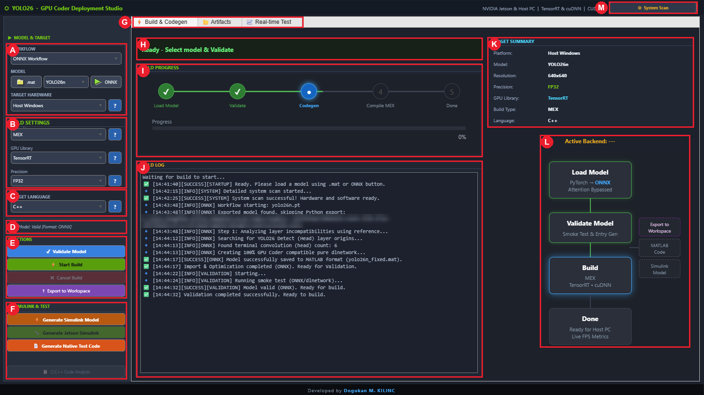

| | Area | Purpose |
|---|---|---|
| **A** | **Model & Target** | *Workflow* (ONNX / PT2), *Model* size (YOLO26n…x), **.mat / .pt2** (pick an existing model file), **ONNX / PT2** (run the import workflow), *Target Hardware* (Host Windows / NVIDIA Jetson). |
| **B** | **Build Settings** | *Build Type* (MEX / EXE / DLL / LIB), *GPU Library* (TensorRT / cuDNN), *Precision* (FP32 / FP16). |
| **C** | **Target Language** | C++ or C. |
| **D** | **Model status lamp** | Yellow = no model / waiting, orange = processing, green = loaded / valid, red = error. |
| **E** | **Actions** | Validate Model, Start Build, Cancel Build, Export to Workspace. |
| **F** | **Simulink & Test** | Generate Simulink Model, Generate Jetson Simulink, Generate Native Test Code, Generate MEX Test Code (PT2 only), C/C++ Code Analysis. |
| **G** | **Tabs** | *Build & Codegen*, *Artifacts*, *Real-time Test*. |
| **H** | **Status banner** | Current state. |
| **I** | **Build progress** | 5-step pipeline + progress bar; the step names follow the action (Host build, Jetson cross-compile, Simulink, Jetson Simulink, MATLAB code, Export). |
| **J** | **Build log** | `[HH:MM:SS][LEVEL][MODULE] message`. |
| **K** | **Target summary** | Platform, model, resolution, precision, library, build type, language. |
| **L** | **Active backend + flow diagram** | MEX / NATIVE, and a live flow chart with side branches (Export, MATLAB code, Simulink, Jetson Simulink). |
| **M** | **System Scan** | Environment check. |

## 3. Built-in help

Every **?** button opens a slide-in panel. The **Detail Level** switch toggles between a plain-language *Basic* explanation and a technical *Professional* one.

| Hardware Target – Basic ① | Hardware Target – Professional ① |
|---|---|
| 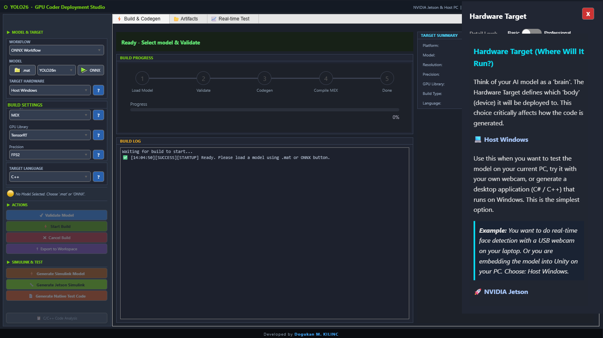 | 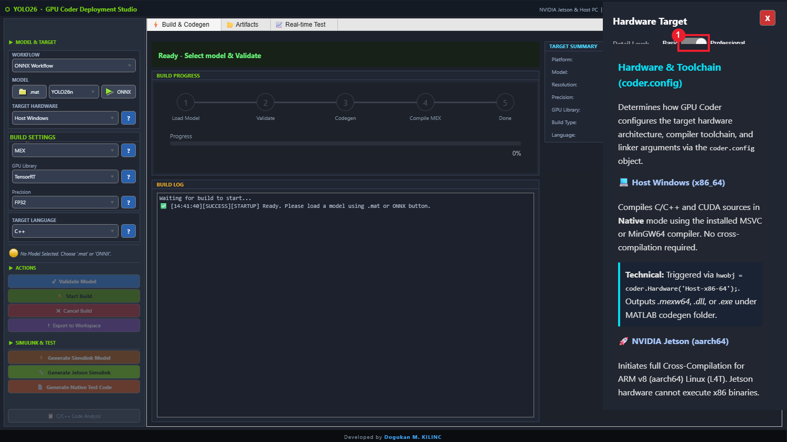 |

| Build Type ① | GPU Library ① |
|---|---|
| 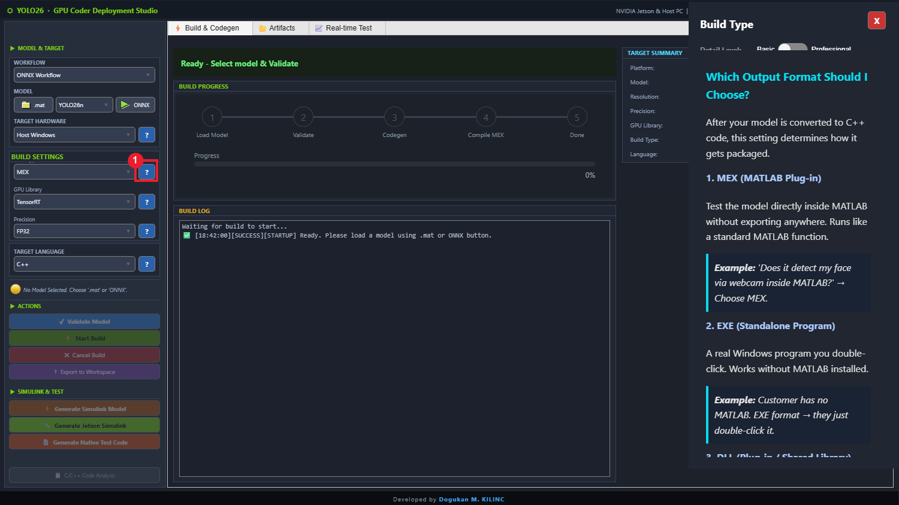 | 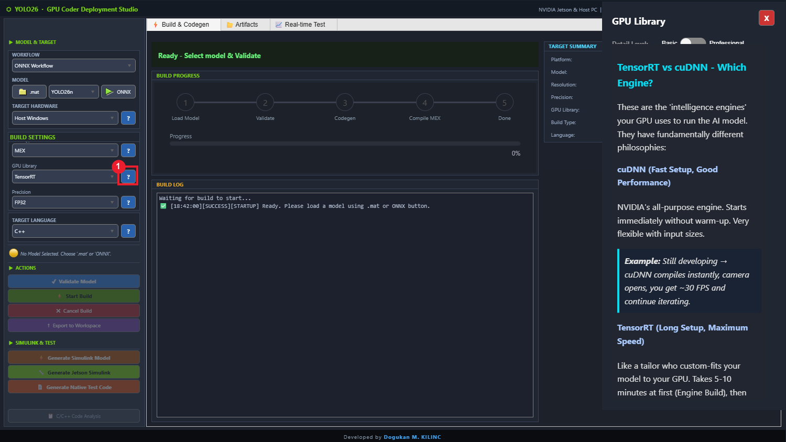 |

| Precision ① | Target Language ① |
|---|---|
| 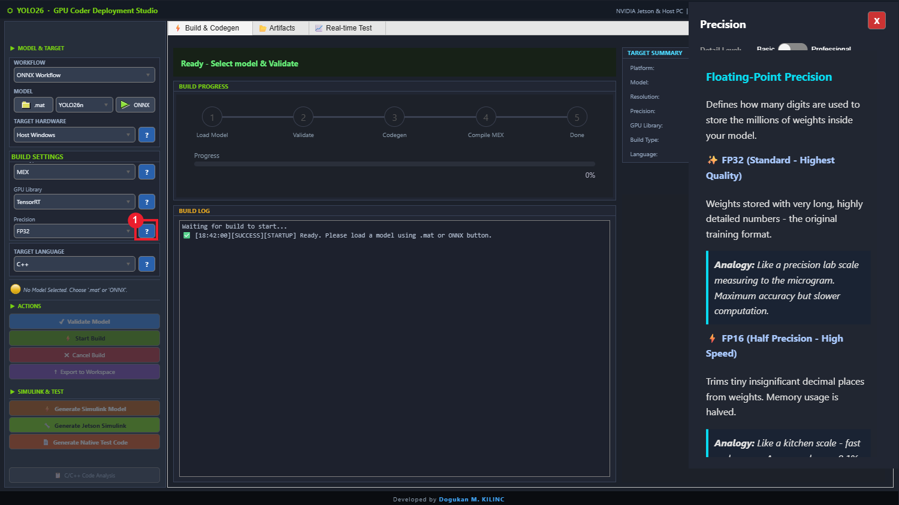 | 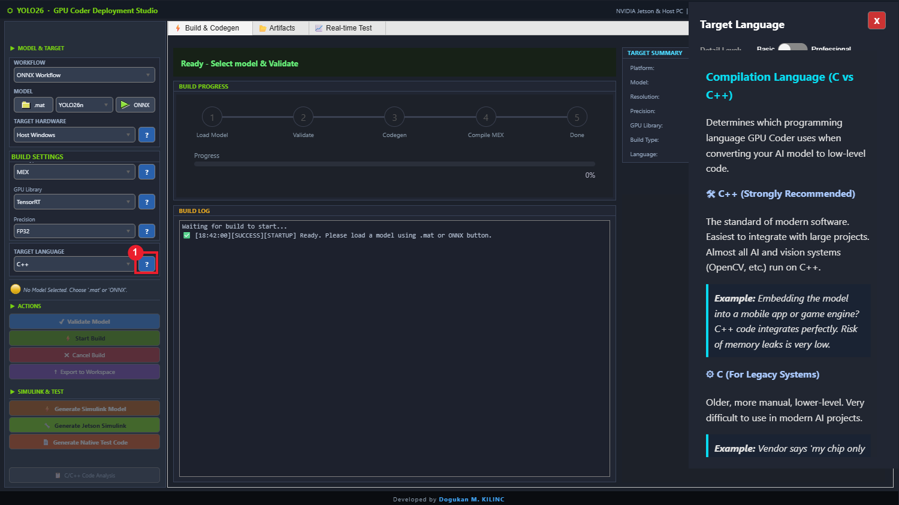 |

---

# Part II – Common steps (every target)

## 4. Load a model

1. ① Select the **Workflow**: `ONNX Workflow` or `PT2 Workflow`.
2. ② Select the **Model** size (`YOLO26n` … `YOLO26x`).
3. ③ Click **ONNX** (or **PT2**) to run the import workflow — or click **.mat / .pt2** to pick an existing model file.

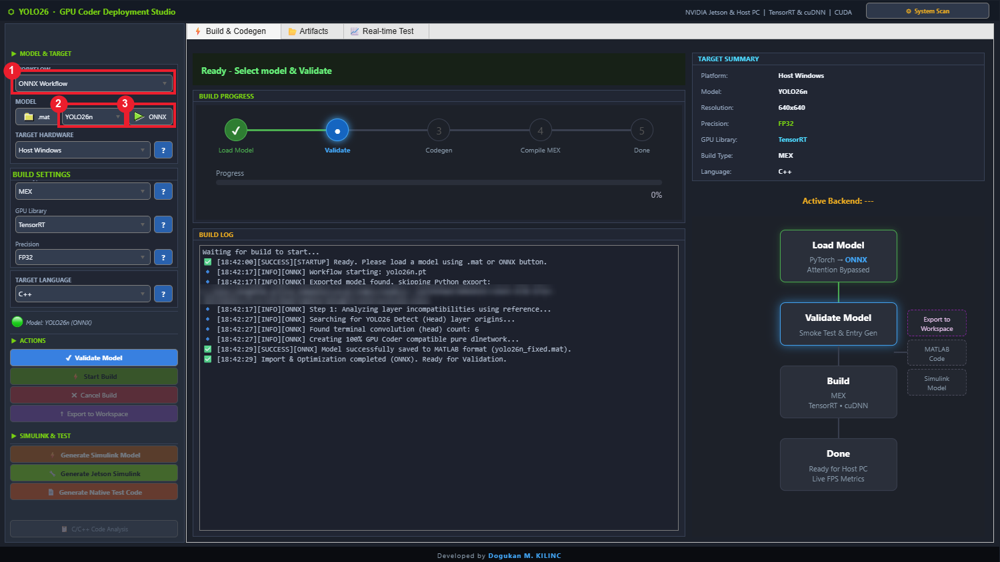

What the **ONNX** button does:

1. If the exported model is already available (the package includes YOLO26n), Python is skipped. Otherwise the app finds Python 3 (MATLAB `pyenv` → `py` launcher → `python` on `PATH`), checks `torch`, `ultralytics`, `onnx` (offers `pip install` if missing) and runs the app's ONNX export step for `yolo26<size>.pt` (Ultralytics downloads the weights on first use).
2. Imports the ONNX file, removes everything after the detection heads and saves the MATLAB model `yolo26<size>_fixed.mat` in the app's model folder.
3. The lamp turns green ("Model: YOLO26n (ONNX)") and **Validate Model** is enabled.

With **PT2 Workflow** the button is labelled **PT2**: the model is exported with `torch.export` and loaded with `loadPyTorchExportedProgram` (kept in memory). PT2 mode also shows the **Generate MEX Test Code** button.

| PT2 workflow ①, PT2 button ② | PT2 model loaded |
|---|---|
| 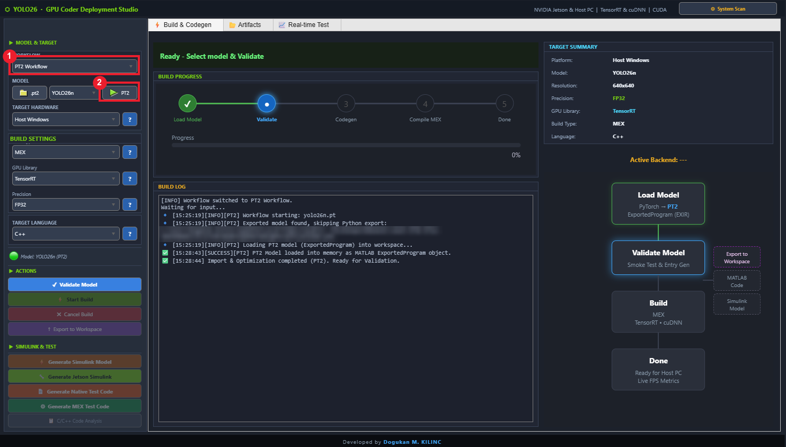 |  |

> [!NOTE]
> On the reference PC the ONNX import took ~30 s; loading the `.pt2` took ~3.5 min.

## 5. Choose the target and build settings

| Setting | Choose… |
|---|---|
| **Target Hardware** | *Host Windows* to run on this PC, *NVIDIA Jetson* to cross-compile for a Jetson / to build Jetson and DRIVE Simulink models (see Part IV). |
| **Build Type** | *MEX* (call from MATLAB, Windows only), *EXE* (stand-alone program), *DLL* (shared library: `.dll` / `.so`), *LIB* (static library: `.lib` / `.a`). |
| **GPU Library** | *TensorRT* (fastest, longer first build) or *cuDNN* (quick, flexible). |
| **Precision** | *FP32* or *FP16* (TensorRT only; needs Tensor Cores for a speed-up). |
| **Target Language** | *C++* (always with TensorRT) or *C* (cuDNN only). |

Invalid combinations are fixed automatically — e.g. selecting **cuDNN** ① limits **Precision** ② to FP32 and allows C:

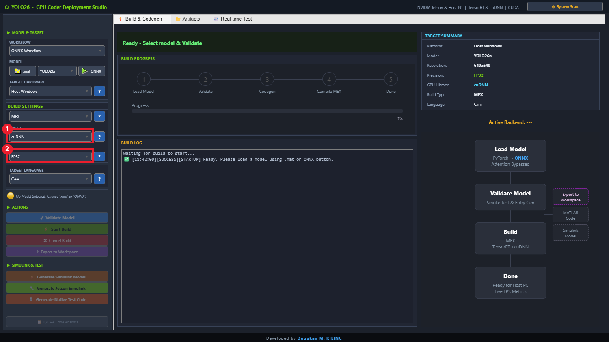

## 6. Validate the model

Click **✔ Validate Model** ①. The model is loaded and a smoke test is run (ONNX: `predict` on a 640×640×3 `dlarray`, on the GPU if available; PT2: `invoke` on a `[1 3 640 640]` single array on the CPU). Nothing is written to disk. Afterwards *Start Build*, *Export to Workspace*, *Generate Simulink Model* and *Generate Native Test Code* are enabled (and *Generate Jetson Simulink* when the target is a connected Jetson).

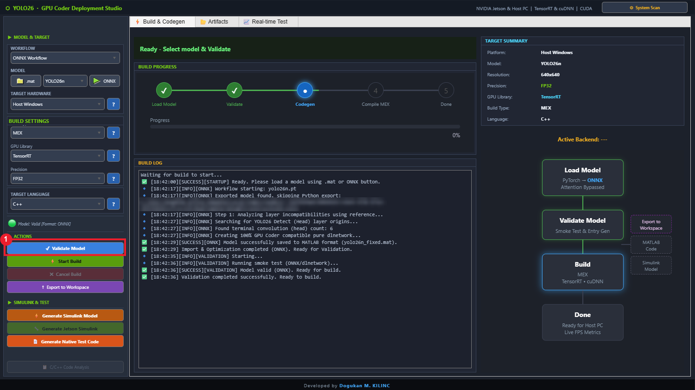

---

# Part III – Host Windows workflow

## 7. Build GPU code for the PC

With **Target Hardware = Host Windows**, click **⚡ Start Build** ①. The build runs on a parallel worker (`parfeval`; a process pool is started automatically), so the UI stays responsive; **✖ Cancel Build** stops it. LIB builds run synchronously (MSVC `lib.exe` does not work inside `parfeval`).

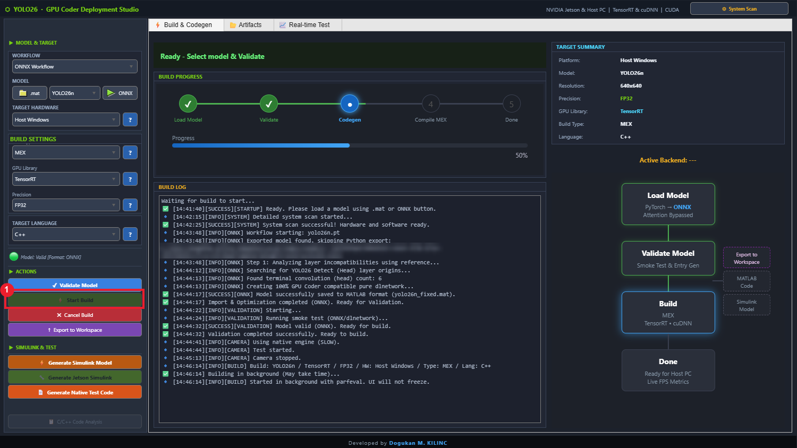

When the build finishes the app reports the output file, runs a **stress test** for MEX builds (one warm-up call — the first TensorRT call builds the engine — plus 20 timed calls) ②, shows **Build Successful – Ready** ①, sets *Active Backend: MEX* and enables **MEX Test (Fast)** and **📋 C/C++ Code Analysis** ③.


If the build fails, the error lines (from the codegen output, `buildLog.log` and the exception chain) are written to the log and the app falls back to native MATLAB inference ("Native Fallback").

## 8. Inspect the generated code

**Artifacts ①** lists every generated `.cu` / `.cpp` / `.h` file and the binary. **🔍 Compiled Output Folder ②** opens the `codegen` folder, **📂 Main Project Folder** the app's working folder.

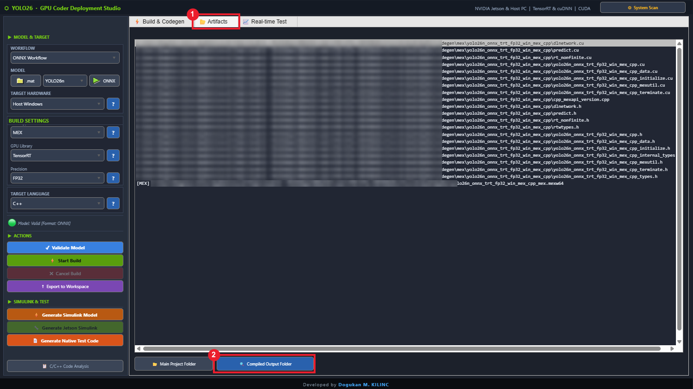

**📋 C/C++ Code Analysis** opens the GPU Coder report: entry-point function, generated files, GPU kernels, build logs and messages.

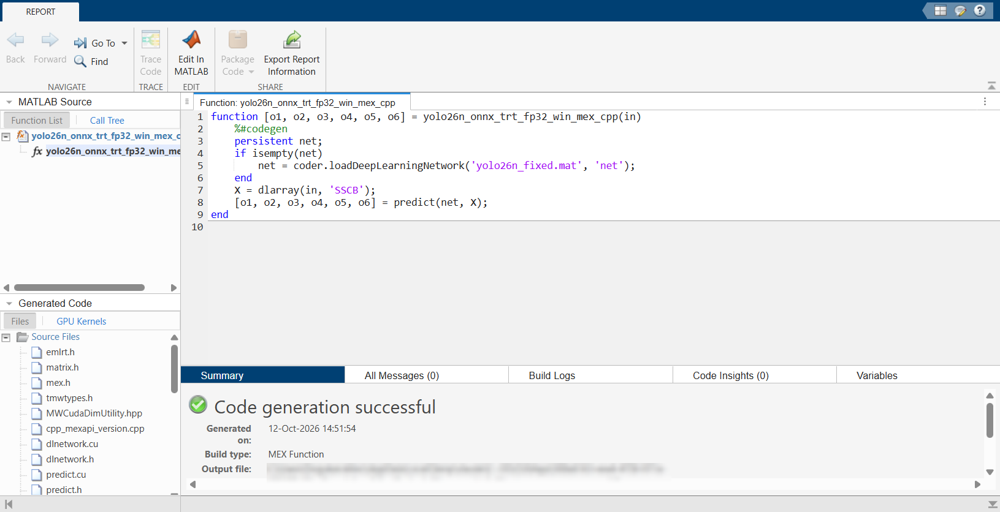

## 9. Real-time test

Open **📈 Real-time Test** ①, pick a camera ② (or **Simulation Mode**, a scrolling panorama of MATLAB demo images) and start:

* **Native Test (Slow)** ③ – runs the network inside MATLAB (needs a validated model).
* **MEX Test (Fast)** – runs the compiled MEX (after a MEX build).
* **⏹ Stop** – stops the camera.

Each frame is resized to 640×640, normalized, run through the network, decoded (threshold, box decoding, NMS) and annotated with COCO labels. The right panel shows the backend, **FPS** (30-frame average), **latency** (inference + decoding), **detections** and **total frames**. The test always runs on the PC.

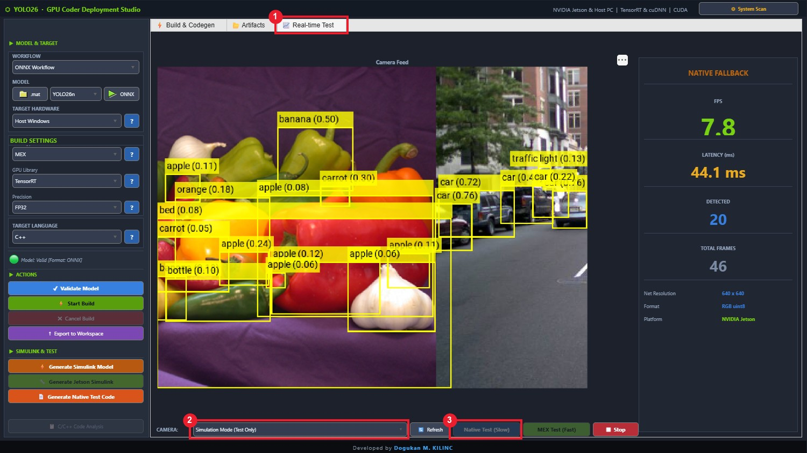


## 10. Desktop Simulink model

**⚡ Generate Simulink Model** ① builds the model `YOLO26_Simulink_Auto` and opens it.

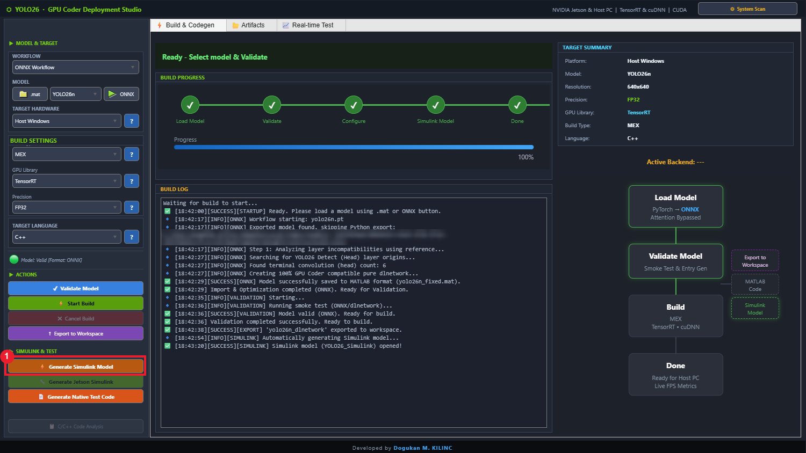

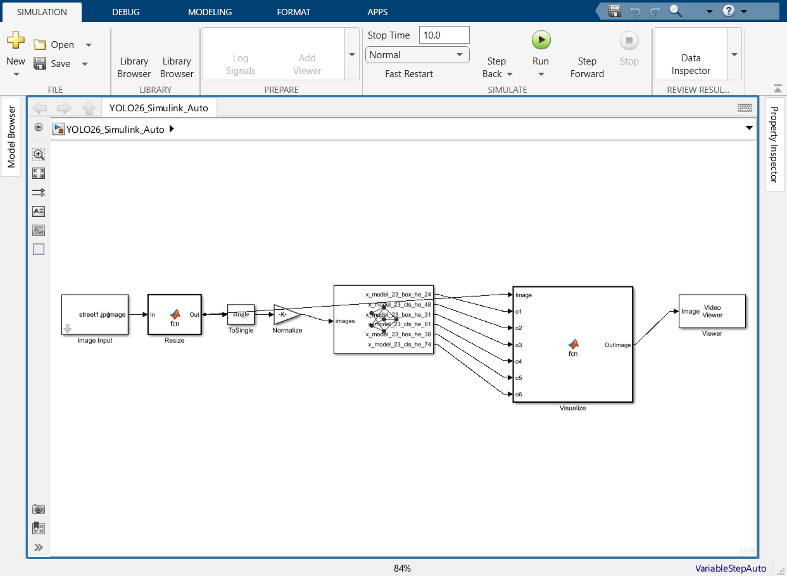

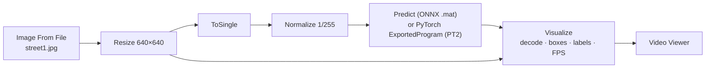

## 11. Test scripts and workspace export

* **📄 Generate Native Test Code** ① writes a stand-alone MATLAB script (model loading, six demo images, post-processing, annotated output) and opens it in the Editor as an *Untitled* document.
* **⚙ Generate MEX Test Code** (PT2, after a MEX build) writes the same script using the compiled MEX.
* **↑ Export to Workspace** copies the validated network to the base workspace as `yolo26<size>_dlnetwork`.

| Generate Native Test Code ① | Output of the generated script |
|---|---|
| 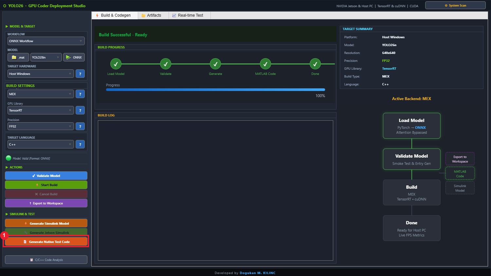 | 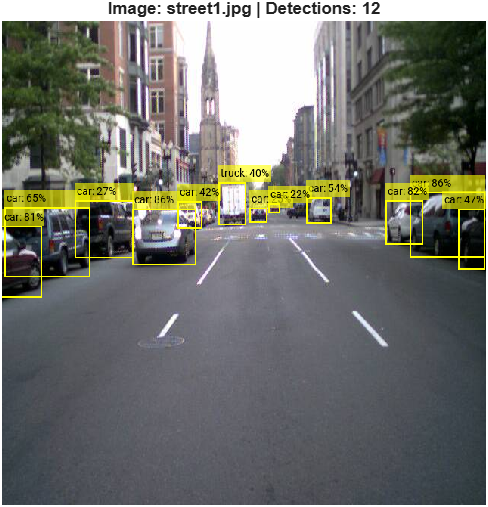 |

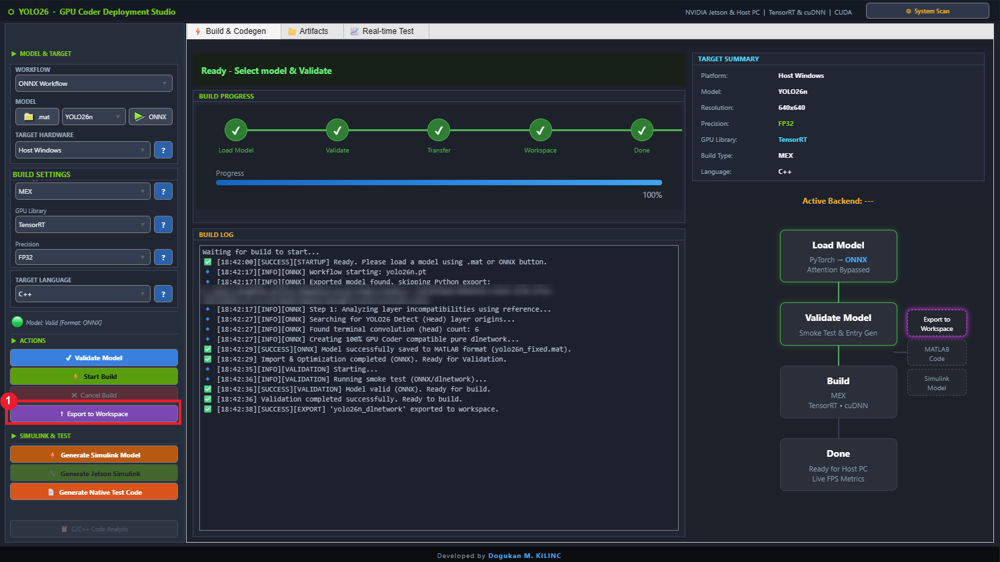

---

# Part IV – NVIDIA Jetson workflow

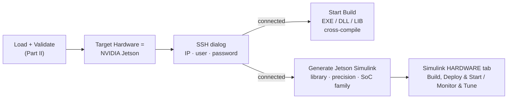

## 12. Prepare the Jetson board

Check this once per board (reference board: **Jetson AGX Orin**, compute capability 8.7):

- [ ] JetPack installed (a version supported by your MATLAB release) including **CUDA, cuDNN and TensorRT**.
- [ ] SDL 1.2 (`sudo apt install libsdl1.2-dev`) for the *SDL Video Display* block; a USB/CSI camera on `/dev/video0` for the camera block.
- [ ] CUDA on the SSH user's environment, e.g. in `~/.bashrc`:
  ```bash
  export PATH=/usr/local/cuda/bin:$PATH
  export LD_LIBRARY_PATH=/usr/local/cuda/lib64:$LD_LIBRARY_PATH
  ```
- [ ] SSH enabled, board and PC on the same network; you know the IP address, user name and password.
- [ ] On the PC: Embedded Coder and the *MATLAB Coder Support Package for NVIDIA Jetson and NVIDIA DRIVE Platforms* are installed.

## 13. Connect to the Jetson

1. Load and validate a model (Part II).
2. Set **Target Hardware** to **NVIDIA Jetson**. The **NVIDIA Jetson SSH Connection** dialog opens:
   ① **Jetson IP Address** — replace the default `192.168.1.50` with your board's address,
   ② **Username** — replace the default `ubuntu`,
   ③ **Password**,
   ④ **OK**.

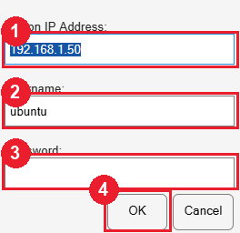

The app tests the connection with `jetson(ip, user, password)` (≈5 s on the reference network).

* **Success:** the log shows *"Jetson SSH connection successful!"* and the window switches to Jetson mode: ① *Target Hardware = NVIDIA Jetson*, ② *Build Type* without MEX, ③ **Generate Jetson Simulink** enabled. The pipeline now reads *Load Model → Validate → Codegen → Cross-Compile → Deploy*, the flow chart shows *Cross-Compile* / *Deployed to Jetson* and a new **Jetson Simulink** side branch.
* **Failure** (wrong IP / user / password, SSH off, different network): an *SSH Connection Error* message appears, the log shows *"Jetson SSH connection rejected."* and the target returns to *Host Windows*. In the screenshot below the first attempt failed because the default IP was left in the dialog.


> [!IMPORTANT]
> The password field of the dialog is not masked — make sure nobody is looking at your screen. The credentials are kept only in the app's memory for the current session (they are used for the cross-compile build) and are not written to disk.

## 14. Cross-compile for the Jetson

1. **Build Type** ① — on Jetson only **EXE** (Linux executable), **DLL** (`.so`) and **LIB** (`.a`) are offered:

   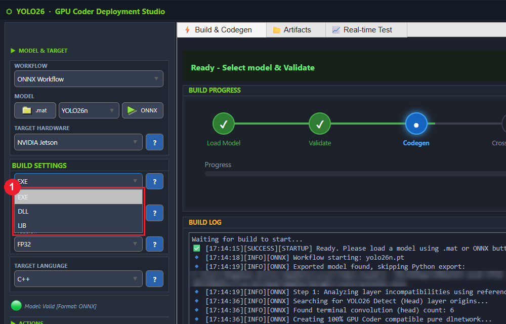

2. Choose **GPU Library** and **Precision** — e.g. TensorRT + FP16 for the Orin's Tensor Cores.
3. Click **⚡ Start Build** ①. The *Target Summary* shows *Platform: NVIDIA Jetson*; the pipeline moves to *Codegen*, followed by *Cross-Compile* and *Deploy*.

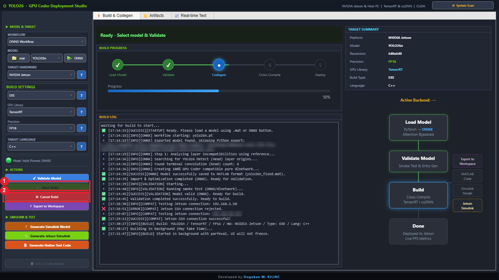

What happens during a Jetson build:

1. An entry-point function is written for the chosen options, e.g. `yolo26n_onnx_trt_fp16_jetson_exe_cpp.m`.
2. GPU Coder is configured with `coder.Hardware('NVIDIA Jetson')` and the board's address / user / password, compute capability **8.7**, the selected deep-learning library and precision.
3. CUDA/C++ code is generated on the PC, copied to the board over SSH and compiled **on the board** with its CUDA / TensorRT toolchain.
4. The app lists the generated sources (`codegen/<type>/<entry>/`) and the Makefile (`<entry>.mk`). If the board cannot be reached after code generation, the result is reported as **SOURCE_ONLY (SSH Connection Error)** — the sources can still be copied and built on the board.

> [!NOTE]
> For this manual the build was started and then stopped with **✖ Cancel Build** ②. After a cancel the status changes to *Build Failed – Native Fallback*; this is expected. A full Jetson build takes several minutes (code generation + on-board compilation).

## 15. Generate the Jetson Simulink model

Click **🔧 Generate Jetson Simulink** (enabled only when the target is a connected Jetson and the model is validated). The **Jetson Simulink Settings** dialog opens:

| Default settings: ① GPU Library ② Precision ③ SoC / Board Family ④ **?** ⑤ Generate | cuDNN selected ① → Precision locked to FP32 ② |
|---|---|
| 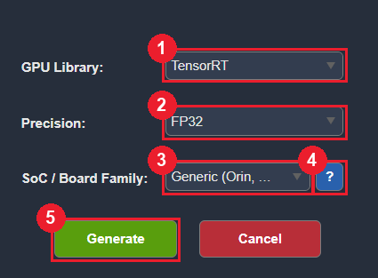 | 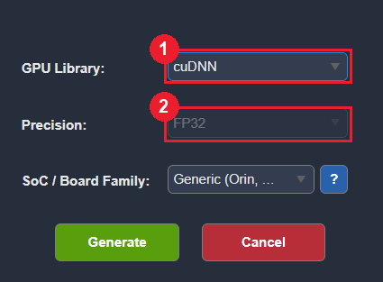 |

**SoC / Board Family** options ① and the **?** information window (*Basic* / *Professional*, switch ①):

| Board family list | **?** – Basic | **?** – Professional |
|---|---|---|
|  | 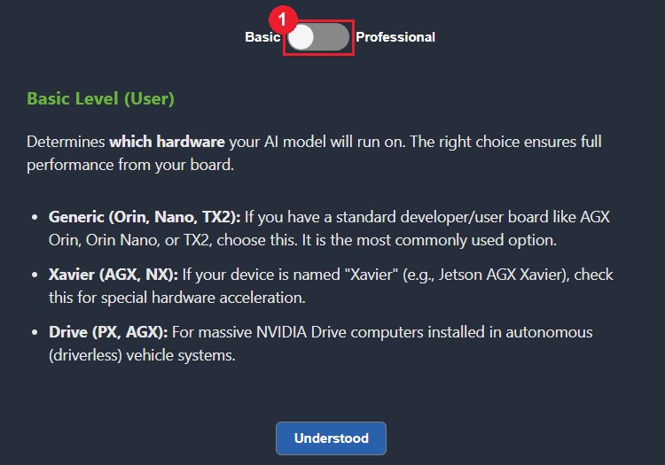 | 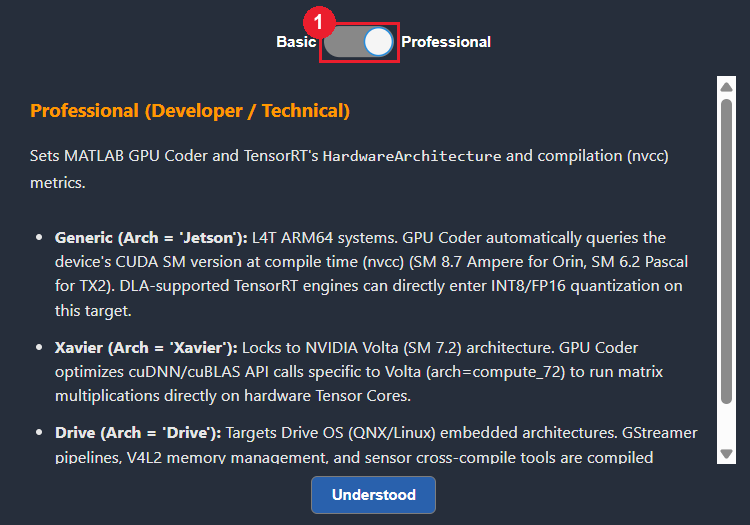 |

| Board family | Use it for | Simulink *Hardware board* set by the app |
|---|---|---|
| **Generic (Orin, Nano, TX2)** | Jetson AGX Orin, Orin Nano, Orin NX, TX2, … (most common) | `NVIDIA Jetson` |
| **Xavier (AGX, NX)** | Jetson AGX Xavier / Xavier NX | `NVIDIA Jetson` |
| **Drive (PX, AGX)** | NVIDIA DRIVE platforms (Part V) | `NVIDIA Drive` |

For the Jetson AGX Orin choose ① **TensorRT**, ② **FP16**, ③ **Generic (Orin, Nano, TX2)** and click ④ **Generate**:

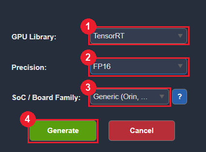

The app builds and opens **`YOLO26_Jetson_Auto`**. The log shows *"Jetson Simulink Model … opened!"* and the pipeline reads *Load Model → Validate → Configure → Jetson Simulink → Done* (≈30 s on the reference PC):

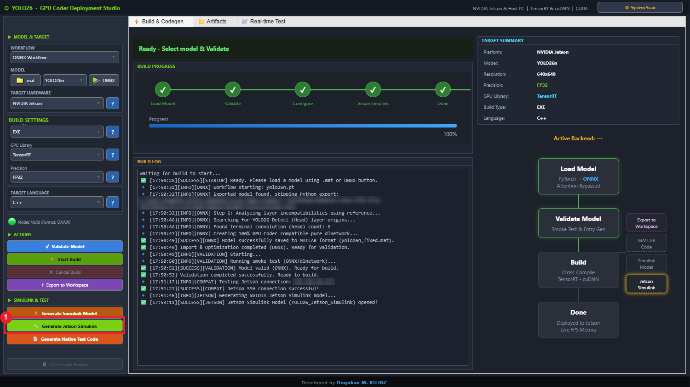

The model:

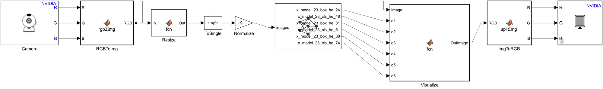

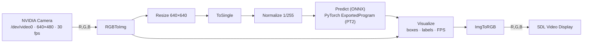

| Model setting | Value |
|---|---|
| System target file | `ert.tlc` (Embedded Coder) |
| Hardware board | `NVIDIA Jetson` (Generic / Xavier) or `NVIDIA Drive` (Drive) |
| Target language | C++ |
| GPU code | CUDA, compute capability 8.7 |
| Deep-learning library | TensorRT or cuDNN; data type FP32/FP16 (TensorRT) |
| Variable-size signals / dynamic memory | on / on |

> [!TIP]
> The model always uses compute capability **8.7** (Orin). For a **Xavier** board change *Configuration Parameters → Code Generation → GPU Code → Compute capability* to **7.2**; for a TX2 to **6.2**.

## 16. Deploy the Simulink model to the board

The model opens on the **HARDWARE** tab:

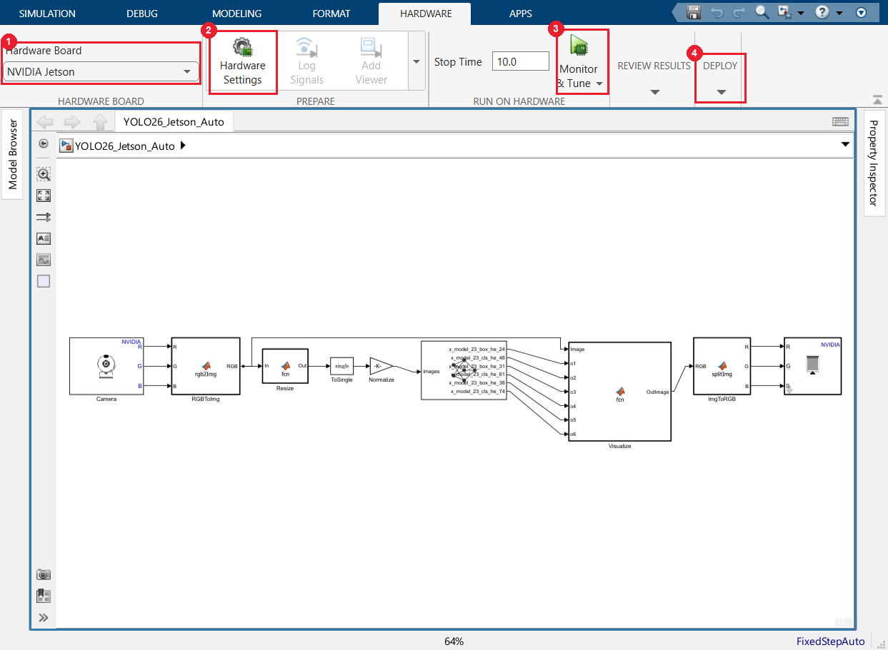

1. ① **Hardware Board** shows `NVIDIA Jetson`.
2. ② **Hardware Settings** → *Hardware Implementation → Target hardware resources → Board Parameters*: enter the board's **Device Address**, **Username** and **Password** (**Edit**). The app does not copy its SSH credentials into the model.

   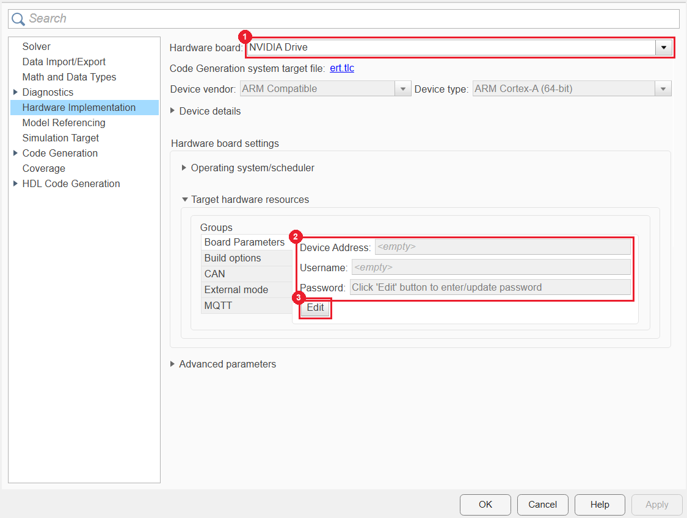

3. ③ **Monitor & Tune** – runs the model on the board while Simulink stays connected (external mode: see signals, tune parameters).
4. ④ **Deploy → Build, Deploy & Start** – generates code for the whole model, builds it on the board and starts it as a stand-alone application; the annotated video appears on the board's display (SDL window).

---

# Part V – NVIDIA DRIVE workflow

## 17. Generate a DRIVE Simulink model

The DRIVE workflow uses the same dialog as the Jetson Simulink model; only the board family differs.

1. Load and validate the model (Part II).
2. **Target Hardware = NVIDIA Jetson** and connect with the IP address, user name and password of the board (§13) — the Simulink button is enabled only after a successful connection.
3. Click **🔧 Generate Jetson Simulink**, open **SoC / Board Family** and pick ① **Drive (PX, AGX)**; choose library and precision; click ② **Generate**:

   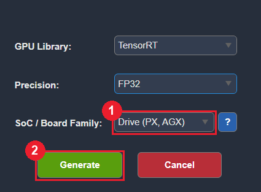

4. `YOLO26_Jetson_Auto` opens with **Hardware Board = NVIDIA Drive** ① (same blocks as in §15):

   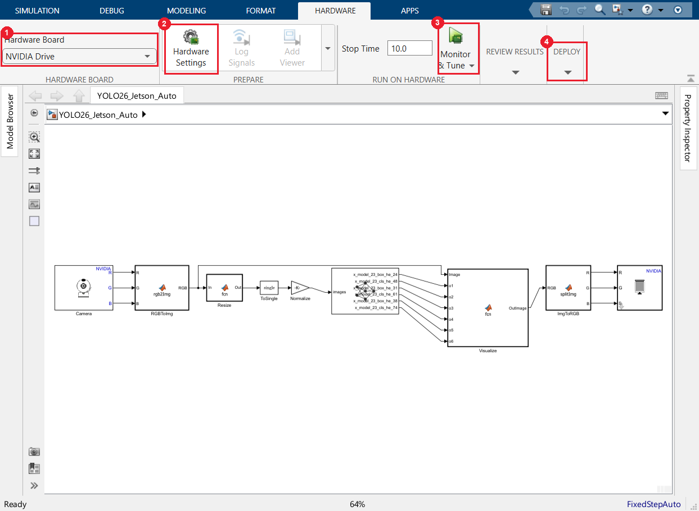

5. ② **Hardware Settings**: the board is `NVIDIA Drive` ① (ARM Cortex-A 64-bit, `ert.tlc`); enter the DRIVE platform's **Device Address / Username / Password** ② (password via **Edit** ③):

   

6. Use ③ **Monitor & Tune** or ④ **Deploy → Build, Deploy & Start** as in §16.

> [!NOTE]
> **Start Build** in the app always cross-compiles with `coder.Hardware('NVIDIA Jetson')`. For NVIDIA DRIVE use this Simulink route. The DRIVE platform needs DRIVE OS with CUDA, cuDNN and TensorRT, and the same support package on the PC.

---

# Part VI – Under the hood

## 18. How the code is generated

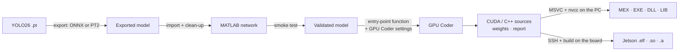

### 18.1 Export

* **ONNX:** before writing the ONNX file (opset 14, 640×640, batch 1, static shapes, FP32) the app adapts the Ultralytics model for MATLAB: the detection head returns **six raw tensors** (box distances and class scores for strides 8, 16 and 32) so that post-processing runs in MATLAB; channel-split and attention operations are rewritten in a form GPU Coder supports; the attention branch of the PSA blocks is bypassed (this can change accuracy slightly).
* **PT2:** the model is exported with `torch.export` with end-to-end NMS disabled, which keeps the graph TensorRT-friendly; it returns one `[1, 84, 8400]` tensor (4 box values + 80 class scores for 8400 candidates).

### 18.2 Import and validation

* **ONNX:** the file is imported as a MATLAB network, the detection heads are located and everything after them is removed, giving a pure `dlnetwork`. For YOLO26n: **324 layers, ~2.50 M parameters**, outputs `80×80×4 / 80×80×80` (stride 8), `40×40×4 / 40×40×80` (stride 16), `20×20×4 / 20×20×80` (stride 32).
* **PT2:** the `.pt2` file is loaded as a PyTorch ExportedProgram.
* A smoke test with a 640×640×3 input confirms the network runs before any code is generated.

### 18.3 Entry-point function

GPU Coder generates code from a MATLAB *entry-point function*. The app writes one for every build; its name encodes the selected options:

```
<model>_<source>_<library>_<precision>_<hardware>_<buildtype>_<language>
yolo26n_onnx_trt_fp32_win_mex_cpp        (Host Windows MEX)
yolo26n_onnx_trt_fp16_jetson_exe_cpp     (Jetson EXE)
```

The ONNX entry point loads the network once and calls `predict` (this is the function shown in the GPU Coder report, §8):

```matlab
function [o1, o2, o3, o4, o5, o6] = yolo26n_onnx_trt_fp32_win_mex_cpp(in)
    %#codegen
    persistent net;
    if isempty(net)
        net = coder.loadDeepLearningNetwork('yolo26n_fixed.mat', 'net');
    end
    X = dlarray(in, 'SSCB');
    [o1, o2, o3, o4, o5, o6] = predict(net, X);
end
```

The PT2 entry point loads the ExportedProgram, converts the input to NCHW and calls `invoke`.

### 18.4 GPU Coder settings

| Your choice in the app | GPU Coder setting |
|---|---|
| Build Type | `coder.gpuConfig('mex' / 'exe' / 'dll' / 'lib')`; EXE builds include an example `main` |
| Target Language | `TargetLang = 'C++'` or `'C'` |
| GPU Library, Precision | `coder.DeepLearningConfig('tensorrt' / 'cudnn')`; TensorRT data type `fp32` / `fp16` |
| Host Windows | compute capability of the local GPU; CUDA, cuDNN and TensorRT shipped with MATLAB |
| NVIDIA Jetson | `coder.Hardware('NVIDIA Jetson')` with the board's address and credentials; compute capability 8.7 |
| Input | fixed `single` array 640×640×3×1 |
| Report | the GPU Coder report is always generated |

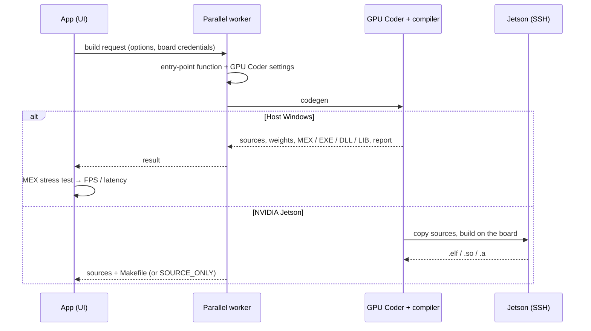

### 18.5 Post-processing

* **ONNX outputs:** sigmoid on the class scores → best class per grid cell → confidence threshold → box from the predicted distances: `x1 = (gx + 0.5 − l)·stride`, `y1 = (gy + 0.5 − t)·stride`, `x2 = (gx + 0.5 + r)·stride`, `y2 = (gy + 0.5 + b)·stride`.
* **PT2 output:** `cx, cy, w, h` + 80 class scores → threshold → corner coordinates.
* **Non-maximum suppression** per class (IoU > 0.45) → boxes, scores and COCO labels (1…80). Confidence threshold 0.20 in the generated test scripts and Simulink models, 0.05 in the real-time test tab.

---

# Part VII – Reference

## 19. Options and compatibility rules

| Rule | Result |
|---|---|
| Target = NVIDIA Jetson | MEX removed → EXE / DLL / LIB |
| Library = cuDNN | FP32 only; C++ or C |
| Library = TensorRT | FP32 / FP16; C++ only |
| Jetson Simulink dialog: cuDNN | Precision disabled (FP32) |
| Generate Jetson Simulink | Requires a validated model **and** a connected NVIDIA Jetson target |

|  | MEX | EXE | DLL | LIB | Simulink model |
|---|:-:|:-:|:-:|:-:|:-:|
| Host Windows | ✔ | ✔ | ✔ | ✔ | Desktop |
| NVIDIA Jetson | ✖ | ✔ | ✔ | ✔ | Jetson (Generic / Xavier) |
| NVIDIA DRIVE | ✖ | – | – | – | DRIVE (via Jetson Simulink dialog) |

## 20. Outputs and file names

| Build type | Host Windows | NVIDIA Jetson |
|---|---|---|
| MEX | `<entry>_mex.mexw64` (app working folder) | – |
| EXE | `codegen\exe\<entry>\<entry>.exe` | `<entry>.elf` (built on the board) |
| DLL | `codegen\dll\<entry>\<entry>.dll` | `.so` |
| LIB | `codegen\lib\<entry>\<entry>.lib` | `.a` |

| Generated by the app | File / object |
|---|---|
| Import (ONNX) | `yolo26<size>_fixed.mat` (MATLAB model) |
| Build | entry-point `<entry>.m`, `codegen/<type>/<entry>/…`, `html/report.mldatx` |
| Generate Simulink Model | model `YOLO26_Simulink_Auto` |
| Generate Jetson Simulink | model `YOLO26_Jetson_Auto` |
| Generate Native / MEX Test Code | *Untitled* script in the Editor |
| Export to Workspace | `yolo26<size>_dlnetwork` |

The generated models are not saved automatically — use **Save** in Simulink if you want to keep them.

## 21. Measured timings

| Step | Reference result |
|---|---|
| System Scan | ~10 s |
| ONNX import (existing `.onnx`) | ~30 s |
| PT2 load | ~3.5 min |
| Validation | ~10 s |
| Host MEX build (TensorRT FP32) | ~5.5 min + ~3 min first TensorRT call |
| **Host MEX stress test** | **25.2 FPS · 39.6 ms** |
| Native real-time test (simulation) | ~7.8 FPS · ~44 ms |
| Jetson SSH connection test | ~5 s (failed attempt ~20 s) |
| Jetson build start (incl. parallel pool) | ~80 s until code generation starts |
| Jetson Simulink model generation | ~30 s |

## 22. Troubleshooting

| Symptom | Cause | Fix |
|---|---|---|
| *Jetson SSH connection rejected* / target jumps back to Host Windows | Wrong IP (the default `192.168.1.50` was left), user or password; SSH off; different network | Enter the board's real IP / user / password; check `ping` and `ssh user@ip` from the PC. |
| **Generate Jetson Simulink** is grey | Target is not a connected Jetson or model not validated | Connect (§13) and validate (§6). |
| Jetson build ends with **SOURCE_ONLY (SSH Connection Error)** | Board not reachable during the remote build | Check the network; or copy `codegen/<type>/<entry>` to the board and run the Makefile there. |
| *SDL Video Display* / camera errors on the board | Missing SDL 1.2, no camera on `/dev/video0` | `sudo apt install libsdl1.2-dev`; connect a camera; check `ls /dev/video*`. |
| CUDA not found during the on-board build | `PATH` / `LD_LIBRARY_PATH` not set for the SSH user | Add the CUDA exports to `~/.bashrc` (§12). |
| Wrong GPU architecture on Xavier / TX2 | Model uses compute capability 8.7 | Set 7.2 (Xavier) or 6.2 (TX2) in the model's GPU Code settings. |
| *Python 3 was not found* | No usable interpreter | Install Python 3.10–3.12 (add to PATH) or set `pyenv`; not needed when the exported model exists. |
| *TensorRT Missing* | GPU Coder TensorRT library not installed | `gpucoder.installTensorRT` |
| *No C++ compiler selected* | No MEX compiler | `mex -setup C++` → MSVC |
| Build fails → *Native Fallback* | See the log | `coder.checkGpuInstall` |
| First MEX call very slow | TensorRT engine build | Wait; later calls are fast. |
| Only *Simulation Mode* in the camera list | USB Webcams support package missing / no camera | Install it, press **🔄 Refresh**. |
| UI freezes during LIB build | LIB builds are synchronous | Wait. |
